# Avaota-A1 (Allwinner T527 / A527): JTAG and DRAM-training notes

Research notes for the YuzukiHD / Pine64 **Avaota-A1** board. They answer seven questions:

1. How do I enable JTAG on this chip? (Section 1)
2. Can I use this cheap board to learn DRAM (LPDDR4) training? (Section 2)
3. Would an NXP i.MX board be a better buy, and is DDR training in demand? (Sections 2.6 and 2.7)
4. How do the Avaota-A1, FRDM-IMX93 and FRDM-IMX95 Pro compare for DDR work, and does i.MX95 PHY-firmware reverse engineering carry over to the i.MX93? (Sections 2.16 and 2.17)
5. What can you learn about DRAM with T113-S3, RZ/V2L SMARC, Avaota-A1, FRDM-IMX93 and FRDM-IMX95 Pro together? (Section 2.18)
6. Which parts of this actually pay off for an embedded Linux BSP job target? (Section 2.19)
7. What does the Avaota-A1 add over your T113-S3 board, and can the T527 do instruction trace like the i.MX95? (Section 3)

Everything here was checked on 2026-10-22 against the files in this repo (schematic v1.7, BOM v1.7, the Allwinner manuals) and against upstream source code (xfel, SyterKit, U-Boot and OpenOCD). Nothing has been tried on a real board yet. Steps that depend on hardware behaviour are marked **(untested)**.

---

## 0. Board at a glance

| Item | Value | Where it comes from |
|---|---|---|
| SoC | **T527** on the BOM (part `U14`). Pine64 sells the board as "A527". Both chips are the sun55iw3 family, and the JTAG pin mux and GPIO registers are the same in the A527 and T527 manuals. | BOM v1.7, schematic sheet 4 |
| DRAM | 1× LPDDR4 FBGA200 chip (`UD1`), 32-bit bus | BOM v1.7, SyterKit DT |
| PMIC | AXP717 (`U4`) and AXP323 (`U5`) | BOM v1.7, schematic sheet 3 |
| Storage | microSD (SDC0 on PF0–PF6), eMMC (SDC2), SPI NAND W25N01GV (`U18`) | BOM v1.7 |
| Debug UART | UART0 on PB9/PB10, 40-pin header **pin 8 = TX, pin 10 = RX**, 3.3 V | schematic sheets 6 and 9 |
| FEL (USB recovery) | `FEL1` push-button | schematic sheet 4 |
| I/O voltage | VCC-IO and VCC-CARD both come from AXP717 CLDO3 at **3.3 V** | schematic sheet 3 |
| Price | Pine64 store, 4 GB/32 GB: "community price" **$54.95** (2 GB/16 GB: $39.95), without shipping | [pine64.com](https://pine64.com/?p=358314) |

Repo layout:

- [1.hardware/Avaota-A1](1.hardware/Avaota-A1): YuzukiHD open hardware. Contains schematics v1.2–v1.7, BOM, Gerbers, Altium/EasyEDA projects, LPDDR4 layout templates (`resource/dram_4l`, `resource/dram_8l`) and IBIS models.
- [2.docs/docs](2.docs/docs): Allwinner documentation: A523/A527/T527/A733/T736 manuals, hardware design guides and SDK guides.

---

## 1. JTAG

### 1.1 Short answer

The microSD sniffer + CH347F setup used on the **T113** should work here without changes. On T527 the main-CPU JTAG sits on the same SD pins, in the same register (`PF_CFG0 @ 0x020000F0`), with the same function number (3).

There is one difference. **On Avaota-A1, nothing turns JTAG on by default.** You have to switch PF0/PF1/PF3/PF5 to function 3 yourself, and then stop anything else from switching them back to SD mode:

```
PF_CFG0 @ 0x020000F0  <=  0x0F3F3F33
        PF0=3 JTAG-MS(TMS)  PF1=3 JTAG-DI(TDI)  PF3=3 JTAG-DO(TDO)  PF5=3 JTAG-CK(TCK)
        PF2, PF4, PF6 = 0xF (I/O disabled)
```

`PF_CFG0` resets to `0x0FFF_FFFF` (all pins disabled). See A527 User Manual §8.6.6.45.

### 1.2 JTAG ports on the chip, and which ones the board wires out

| Port | Pins (mux function) | What it debugs | On Avaota-A1 |
|---|---|---|---|
| **CPUX JTAG** | PF0 TMS, PF1 TDI, PF3 TDO, PF5 TCK (func 3) | 8× Cortex-A55 | **microSD socket**: use this one |
| CPUX JTAG, alternate | PB0 TMS, PB1 TCK, PB2 TDO, PB3 TDI (func 4) | 8× Cortex-A55 | Only on the 50-pin RGB-LCD FPC (`FPC1`), pins 7/8/15/16 (LCD0-D0/D1/D8/D9). Needs a 0.5 mm FPC breakout. |
| S-RJTAG (T527 also has S-DJTAG) | PL8 TMS, PL9 TCK, PL10 TDO, PL11 TDI (RJTAG func 4; DJTAG func 3 on T527) | XuanTie E906 RISC-V (and the HiFi4 DSP on T527) | 40-pin header **pins 32, 31, 33, 36**. These pins are shared with the SPI-LCD nets (backlight enable, on-board SPI TFT). |
| S-JTAG | PL4–PL7 (func 2) | CPUS | Not connected |
| S-RJTAG, alternate | PM2–PM5 (func 3) | E906 | Only PM2/PM3 are wired (STWI1, header pins 28/29). PM4/PM5 are not connected, so this port is unusable. |

**The JTAG-SEL ball (G16)** is left floating on this board, and the internal pull-up makes it read 1. The A527/T527 hardware design guides define it as:

- `1` (default): software can route CPUX JTAG to **PF (default)** or PB.
- `0`: JTAG is forced onto PB.

The ball has no test pad, so leave it alone.

### 1.3 Wiring: microSD sniffer → CH347F

| microSD pin | SD signal | T527 pin | JTAG | CH347F |
|---|---|---|---|---|
| 1 | DAT2 | PF5 | **TCK** | TCK |
| 2 | CD/DAT3 | PF4 | (UART0-RX) | leave open |
| 3 | CMD | PF3 | **TDO** | TDO |
| 4 | VDD | VCC-CARD, 3.3 V | — | Reference only. Do not power the board from it. |
| 5 | CLK | PF2 | (UART0-TX) | leave open |
| 6 | VSS | GND | **GND** | GND |
| 7 | DAT0 | PF1 | **TDI** | TDI |
| 8 | DAT1 | PF0 | **TMS** | TMS |

- This is the same mapping as the linux-sunxi microSD breakout (DAT2→TCK, CMD→TDO, DAT0→TDI, DAT1→TMS). A sniffer wired for T113 fits as-is.
- Set the CH347F I/O to **3.3 V**.
- The SD slot carries no nTRST or nSRST. Leave CH347F **pin 8 (SRST)** unconnected, because the CH347F drives it low hard at power-up.
- For the console, use UART0 on header pins 8/10 rather than PF2/PF4. Muxing UART0 onto both PB9/PB10 and PF2/PF4 at once would give two inputs on one RX.

### 1.4 Why it "just works" on T113 but not here

- **xfel**: `xfel jtag` on T113 (`chips/r528_t113.c`) runs a small payload that sets PF0/1/3/5 to function 3 in `0x020000F0`. On the A523/A527/T527 family (`chips/a523_a527_t527.c`, xfel master 2026-09-14), `chip_jtag()` is an **empty stub that returns 0**, so `xfel jtag` does nothing. Use `xfel write32` instead (method A below).
- **Boot chain**: every boot-select option printed on schematic sheet 4 probes **SMHC0 (the SD slot) first**, so the BROM switches PF to SD mode while it probes. SyterKit (`mmc0_pins`: PF0–PF5, function 2), U-Boot and Linux also take PF0–PF5 for `mmc0`. On T113, your image or tooling had already put these pins in JTAG mode for you.
- **Correction, from your own T113 measurement:** elb1 field doc 07 §7 (2026-10-06) found that the T113 **boot ROM itself muxes the JTAG pins in FEL**, so no write was needed there. The T527 boot ROM may do the same.
  - **Check:** enter FEL and run `xfel read32 0x020000f0`. If PF0/1/3/5 already read function 3 (`…3?3?33`), attach directly; xfel's empty `chip_jtag()` may simply mean nothing is needed.
  - **If not,** use method A below.

### 1.5 Five ways to turn it on

**A. FEL mode.** No software changes. This is the best method for bring-up, and for stepping through your own SPL or DRAM-init code. **(untested)**

```sh
# Hold FEL1 and power on (or press reset), with the USB OTG port connected to the PC
xfel version                          # family ID is 0x00189000 (A523/A527/T527)
xfel write32 0x020000f0 0x0f3f3f33
xfel read32  0x020000f0               # expect 0x0f3f3f33
openocd -f avaota-a1-ch347.cfg        # see 1.6
```

In FEL mode the A55 runs the BROM in AArch32 state. Code you later load with `xfel write` + `xfel exec` keeps JTAG only as long as it does not re-mux PF.

**B. Vendor BSP boot0** (Tina / AIoT Linux SDK). Add this to `sys_config.fex`:

```ini
[jtag_para]
jtag_enable = 1
jtag_ms = port:PF00<3><default><default><default>
jtag_ck = port:PF05<3><default><default><default>
jtag_do = port:PF03<3><default><default><default>
jtag_di = port:PF01<3><default><default><default>
```

`update_boot0` copies these values into the boot0 header. In the boot0 main flow, `enable_jtag → boot_set_gpio` runs **before `init_DRAM`** (Linux_SPL-PUB guide §5.1), so JTAG is already live while libdram trains the DRAM. The Tina config guide (§3.2.10) uses PB14–PB17 in its example. On T527, use the PF pins shown above.

You must boot from eMMC with this method. U-Boot and Linux will still claim `mmc0` later, so either disable it or use method D.

**C. SyterKit or mainline U-Boot SPL.** Add one read-modify-write early in board init:

```c
/* PF0/PF1/PF3/PF5 -> JTAG (function 3); leave PF2/PF4/PF6 untouched */
u32 v = readl(0x020000f0);
v &= ~0x00f0f0ff;
v |=  0x00303033;
writel(v, 0x020000f0);
```

Also disable `mmc0` in that build and boot from eMMC.

**D. From a running Linux system.** Use this to attach to a live kernel. **(untested)**

```sh
# Release PF0-PF5 from the SD driver. The device name is 4020000.mmc (mainline)
# or 4020000.sdmmc (BSP); check under /sys/bus/platform/drivers/sunxi-mmc/
echo 4020000.mmc > /sys/bus/platform/drivers/sunxi-mmc/unbind
devmem 0x020000f0 32 0x0f3f3f33
```

Boot the kernel with `cpuidle.off=1`. Otherwise idle A55 cores power down and drop the debug session.

**E. The alternate PB route.** **(untested)** This is the **same CPUX debug port** (same DAP, same 8× A55, same OpenOCD config). Only the pins differ. Use it when you want to keep the SD slot free, for example to boot from SD while debugging.

- **Pins:** PB0–PB3 with mux function **4** (not 3). They are only wired to the 50-pin RGB-LCD connector `FPC1` (0.5 mm pitch), so you need an FPC breakout board.

  | FPC1 pin | Net | T527 pin | JTAG |
  |---|---|---|---|
  | 7 | LCD0-D0 | PB0 | TMS |
  | 8 | LCD0-D1 | PB1 | TCK |
  | 15 | LCD0-D8 | PB2 | TDO |
  | 16 | LCD0-D9 | PB3 | TDI |
  | 5, 6 (also 31, 39, 44, 50) | GND | — | GND |
  | 3, 4 | VCC-3V3 | — | I/O reference |

- **Enable it:** `PB_CFG0` is at `0x02000030` (reset value `0xFFFF_FFFF`). Set its low 16 bits to `0x4444`. From FEL: `xfel write32 0x02000030 0xffff4444`. In code: `v = readl(0x02000030); v = (v & ~0xffff) | 0x4444; writel(v, 0x02000030);`
- **Use one route at a time.** Leave PF0–PF5 out of function 3 while you use PB. JTAG-SEL is high on this board, which the design guide describes as "software selects PF or PB". I found no register for this other than the pin mux, so treat it as untested.
- **Costs:** the RGB LCD can't be used at the same time, and the FPC breakout is fiddlier to wire than an SD sniffer.

### 1.6 OpenOCD

- The **CH347 driver** has been in OpenOCD master since **2025-08-24**. It is not in any tagged release (the last tag is v0.12.0, January 2023), so **build OpenOCD from git**. The CH347F is auto-detected (VID `0x1a86`, PID `0x55de`).
- There is **no upstream T527/A523 target config**. The closest templates are `tcl/target/allwinner_h618.cfg` (4× A53, `aarch64`) and `tcl/target/rk3588.cfg` (DynamIQ A55 + A76).
- On T113 you used a Cortex-A7 (`cortex_a` target). This chip needs `aarch64` targets with per-core `-dbgbase` / `-cti` addresses, which you read from the ROM table.

Starter config **(untested)**:

```tcl
# avaota-a1-ch347.cfg: starting point, not yet tested on hardware
adapter driver ch347
transport select jtag
adapter speed 1000

# The ARM JTAG-DP IR length is 4. Add -expected-id <idcode> once you have seen the IDCODE.
jtag newtap t527 cpu -irlen 4
dap create t527.dap -chain-position t527.cpu
```

Discovery run:

```sh
openocd -f avaota-a1-ch347.cfg -c init -c "dap init" -c "dap info 0" -c "dap info 1"
```

Take the per-core **Debug** and **CTI** base addresses from the ROM table output. Then add one block per core, modelled on `allwinner_h618.cfg`:

```tcl
cti create t527.cti0 -dap t527.dap -ap-num <AP> -baseaddr <CTI0_BASE>
target create t527.cpu0 aarch64 -dap t527.dap -ap-num <AP> -dbgbase <DBG0_BASE> -cti t527.cti0
```

The A527 manual's CPUX block diagram labels the debug block "Coresight600". If `dap info` fails with ADIv5 errors, try `dap create ... -adiv6`.

### 1.7 Gotchas

- **The SD slot becomes the debug port**, so boot from eMMC (or SPI NAND). With the sniffer inserted, the BROM probes SD first, gets no reply, and falls back.
- **Anything that touches `mmc0` re-muxes PF0–PF5 and JTAG drops.** That includes the BROM, the boot0 card probe, U-Boot `mmc rescan` and Linux card-detect.
- **Idle A55 cores power down** and kill the session. Boot Linux with `cpuidle.off=1`.
- **eFuse**: the Allwinner SDK has `sid_disable_jtag()` (permanent, secure-boot flow only) and secure-debug certificates (A527 UM §9.1.4). Setting `jtag_enable = 0` in `sys_config.fex` only stops boot0 from setting the pins. Retail Avaota boards boot unsigned SyterKit/U-Boot, so the secure-boot fuses (including JTAG-disable) are normally not burned. If `scan_chain` finds nothing after the mux write, check wiring and voltage levels first.
- **Speed**: start at 1 MHz and raise it once the chain is stable. Sniffer flex cables are long.
- The PB route conflicts with an RGB LCD. The PL route conflicts with the SPI-LCD / backlight nets.

---

## 2. Can I learn DRAM training on Avaota-A1?

### 2.1 Verdict

**Yes, for the firmware side of LPDDR4 bring-up and training. No, for PHY internals or signal integrity.**

What makes it a good learning board:

1. **Open-source DRAM init for this exact board.** Mainline U-Boot has `arch/arm/mach-sunxi/dram_sun55i_a523.c` (about 1,500 lines, LPDDR4 + DDR3, merged July 2025) and `configs/avaota-a1_defconfig`. The code is reverse-engineered, but it is readable C that you can modify and rebuild in minutes.
2. **The vendor training is observable.** Allwinner's libdram "soft training" logs per-byte and per-bit eye scans (range / width / center). The guide is in this repo.
3. **It cannot be bricked.** USB FEL lives in the BROM and the `FEL1` button is on the board. Bad DRAM parameters only make the boot fail, and you can recover with `xfel`.
4. **JTAG works before DRAM is up.** The SPL runs from SRAM, so you can halt in the middle of training (Section 1).
5. **The DRAM rail is adjustable.** VCC-DRAM comes from AXP717 DCDC3, which the schematic marks "软件调整" (software-adjusted); mainline sets it to 1160 mV. This allows voltage margining.
6. **The hardware is open.** Schematic, PCB, LPDDR4 layout templates (4-layer and 8-layer) and T527 LPDDR4/4X IBIS models are all available, so you can relate layout to training results.

What limits it:

1. **There are no register docs.** The DRAMC chapter of the A527/T527 user manual (§3.2) is a one-page feature list. `MEMC_DDRC` (`0x0313_0000`) and `MEMC_PHY` (`0x0314_0000`) are undocumented, and the mainline code is full of magic offsets (`//TODO: ???`).
2. **Most training runs in hardware engines inside the PHY.** Software sets bits and polls for write leveling, read-gate calibration and read/write training. You learn the sequence and the results, not the engine's algorithm.
3. **Allwinner's software eye-scan training is a closed blob** (`libdram`): BSP boot0, SyterKit's `soc/sun55iw3/lib/libdram.a`, and xfel's `xfel ddr lpddr4` payload. It is **reversible**, though: see 2.9.
4. **The mainline driver has no command-bus-training step.** CA timing comes from fixed per-bit delays.
5. **One soldered x32 LPDDR4 chip, and no DQ/DQS test points.** You cannot scope eyes (and that would need a multi-GHz scope anyway).

### 2.2 DRAM setup on this board

| | |
|---|---|
| Memory | 1× LPDDR4, FBGA200, x32. One rank on the 4 GB board, auto-detected by both stacks. |
| Controller limits (UM §3.2) | 32-bit DDR3/DDR3L/DDR4/LPDDR3/LPDDR4/LPDDR4X, up to 4 GB, up to 1200 MHz for LPDDR4 |
| Clock used | **1200 MHz** (≈ LPDDR4-2400) in the SyterKit DT and as the U-Boot default for A523 |
| Rails | VCC-DRAM = AXP717 DCDC3 (adjustable); VDD18-DRAM = ALDO4 1.8 V |
| Parameter-select straps | DDR-PARA-SEL-ADC1/2 on GPADC1/GPADC2 (sheet 4). They let one firmware pick between DRAM parameter sets. |

Board parameters, from SyterKit `boards/avaota-a1/board.dts` (U-Boot `avaota-a1_defconfig` uses the same ODT, drive and TPR values):

| Field | Value | Meaning |
|---|---|---|
| `dram_clk` | `1200` | MHz |
| `dram_type` | `8` | LPDDR4 |
| `dx_odt` / `dx_dri` / `ca_dri` | `0x07070707` / `0x0d0d0d0d` / `0x0e0e` | Per-byte ODT and drive strength, CA drive strength |
| `para0` | `0x84848484` | Allwinner's training log prints it as **write DQS**. U-Boot calls it `ODT_EN`. |
| `mr14` | `0x08` | LPDDR4 MR14 (write Vref) |
| `tpr6` | `0x38000000` | Read Vref |
| `tpr10` | `0x802f3333` | Feature bits. U-Boot names: bit 20 write leveling, bit 21 read calibration, bit 22 read training, bit 23 write training, bits 17/18 DQ bit-delay. Only **read calibration and bit-delay** are enabled here. |
| `tpr11` | `0xc7c5c4c2` | Write DQ delay, one byte per lane |
| `tpr12` | `0x3533302f` | Read DQ delay, one byte per lane |
| `tpr13` | `0x860` | Bit 11 = Allwinner soft DQ eye training **on**. Bit 10 = per-bit training **off**. |
| `tpr14` | `0x48484848` | Read DQS delay |

### 2.3 The three software stacks

1. **Allwinner BSP boot0 + libdram (closed).** Parameters live in `[dram_para]` in `sys_config.fex`. Soft training ("眼图自适应", which needs T527 libdram ≥ V0.67) is controlled by `tpr13`: bit 11 runs a per-byte DQ eye scan, and bit 10 adds a per-bit scan. Excerpts from the example log in the guide:
   ```
   [SOFT TRAINING] Dbyte0 rdq 1st dqs_move:0,range: 36~68,width=36,center=0x34
   [SOFT TRAINING] rdq00 move:0,range: 27~71,width=45,center=0x31
   [SOFT TRAINING] rVREF:tpr6=0x3a000000 wVREF:mr14=0x0000000e
   [SOFT TRAINING] rDQ: tpr12=0x38353234 wDQ: tpr11=0xd7d6d6d7
   ```
   Allwinner's rules of thumb:
   - Eye width **< 32** steps means small margin. Width **< 24** points to a likely performance problem.
   - To get fixed parameters, train 5–8 boards and take the middle value.
   - Training runs once, at first boot or during USB flashing, and the result is written back to flash.
   - Production firmware does not print the detailed log. Allwinner's DragonHD tool (Windows, in APST) shows it.
2. **SyterKit** (YuzukiHD). It uses the same libdram blob, but the parameters live in a small DT and the build is fast. This is the easiest place to flip `tpr13` bits and read the boot log.
3. **Mainline U-Boot SPL (open source).** The flow:
   1. `mctl_sys_init`: sets PLL5 to 2× the DRAM clock and handles resets.
   2. Detects rank, width and size at 360 MHz with safe delays.
   3. Re-initialises at `CONFIG_DRAM_CLK`:
      - `mctl_ctrl_init`: DesignWare-style controller, with helpers shared with H6/H616.
      - `mctl_phy_init`.
      - `mctl_phy_write_leveling`, `mctl_phy_read_calibration`, `mctl_phy_read_training` and `mctl_phy_write_training`, each gated by its TPR10 bit.
      - `mctl_phy_bit_delay_compensation`, using `tpr11`/`tpr12`.

   Read and write training read the left/right eye-edge registers of each lane (for example PHY `+0x850` vs `+0x898`, nine entries per group). Training fails if any window is ≤ 6 taps. **That check is a good place to add a `printf` and get your own per-bit eye report.**

### 2.4 Suggested exercises

1. Read `dram_sun55i_a523.c` next to the JEDEC LPDDR4 spec (JESD209-4) init and training sequence, and annotate every step.
2. Build U-Boot `avaota-a1_defconfig`. Print the eye-edge registers, then turn on TPR10 bits 20/22/23 (hardware write leveling, read training, write training) and compare the results with the fixed `tpr11`/`tpr12`.
3. Run a **shmoo**: sweep `CONFIG_DRAM_CLK` (Allwinner steps in 24 MHz), ODT, drive strength and Vref. Test each point with U-Boot `mtest`, Linux `memtester` or `stressapptest`, and plot pass/fail. Allwinner's own margin test runs DRAM **48 MHz above** the production frequency.
4. **Voltage margining** with AXP717 DCDC3. Stay inside the LPDDR4 VDD2/VDDQ operating range (1.06–1.17 V).
5. Set `tpr13` bit 10 in SyterKit and compare the vendor's per-bit eye widths with what the mainline training finds.
6. Use **JTAG**: halt the SPL during training and change PHY delay registers live. Also dump `0x0313_0000` / `0x0314_0000` after the vendor blob finishes and diff them against mainline; this is how the mainline driver was reverse-engineered.
7. Look at the SI side: open the LPDDR4 layout templates ([resource/dram_4l](1.hardware/Avaota-A1/resource/dram_4l), [resource/dram_8l](1.hardware/Avaota-A1/resource/dram_8l)) and the [T527 LPDDR4 IBIS model](<2.docs/docs/T527/Hardware硬件类文档/硬件设计/IBIS模型/t527_lpddr4_allwinner.ibs>) to see why the lanes train to different delays.

### 2.5 Price and value

Pine64 lists the 4 GB / 32 GB board at **$54.95** (checked 2026-10-22). The ~$75 figure probably includes shipping or comes from another store. For that money you get an LPDDR4 x32 platform with an open-source DRAM driver, FEL recovery and JTAG, which is very good value for learning.

I picked this board because it is cheap. Section 2.6 checks whether an NXP i.MX board would be a better buy, and section 2.7 looks at whether DDR training is worth learning for the job market.

### 2.6 Avaota-A1 vs NXP i.MX and other cheap boards

**What NXP offers.** The NXP DDR tool is part of Config Tools for i.MX (a download that needs an NXP account). It is the standard workflow for i.MX board bring-up:

- Generate the DDR configuration for your board.
- Load a test image into on-chip RAM over USB. No flash or OS is needed.
- Run training ("Firmware Init").
- Run stress tests, including overnight runs.
- Sweep ODT and Vref for DQ and CA.
- Draw **virtual eye diagrams** (vTSA): RX/TX data eye, CA bus margin and CA eye, for LPDDR4.

NXP lists support for i.MX 8M, 91, 93, 95, 943, 93W and 952. This is the tool employers expect you to know for i.MX boards.

**What NXP does not offer either:**

- The training itself is Synopsys DDR PHY firmware (the PMU binaries `lpddr4_pmu_train_*` in `firmware-imx`). NXP says the source is not available, not even to its customers.
- U-Boot's `drivers/ddr/imx/imx8m/ddrphy_train.c` only loads that firmware, writes the message block, runs the PMU and reads back the result.
- The reference manuals document the DDR controller but not the PHY. For example, the i.MX95 RM has chapter 114 DDRC with 122 register descriptions, but no PHY register chapter.

**So the two boards teach different things.**

- **NXP**: the industrial validation workflow, with polished visibility (eyes, margins, stress results).
- **Avaota-A1**: what the init code actually does, with source code and JTAG.
- Neither shows how the PHY's training engine works inside.

Prices below were checked 2026-10-22. They are distributor snapshots and are not like-for-like on tax.

| Board | SoC / CPU | DRAM | Price | DDR tooling | Open training code |
|---|---|---|---|---|---|
| **Avaota-A1 4 GB** | T527, 8× A55 | LPDDR4 x32, 4 GB | **$54.95** (Pine64) | Allwinner DragonHD (Windows) + libdram soft-training logs | **Yes**: mainline U-Boot (reverse-engineered) |
| FRDM-IMX91S | i.MX91, 1× A55 1.4 GHz | LPDDR4, 512 MB | ~US$51 / €41.25 ex VAT (Farnell) | NXP DDR tool | U-Boot + Synopsys firmware blob |
| FRDM-IMX91 | i.MX91, 1× A55 1.4 GHz | LPDDR4, 1 GB | ~S$108 / AU$120 ex GST (element14) | NXP DDR tool | same as above |
| **FRDM-IMX93** (already owned) | i.MX93, 2× A55 1.7 GHz + M33 + NPU | LPDDR4X, 2 GB | ~$71–74 (Future), €69–71 (DigiKey) | NXP DDR tool | same as above |
| MaaXBoard Mini | i.MX8M Mini, 4× A53 | LPDDR4 | $72.50 at launch (2020); now $149.95 with 0 stock (Avnet), €133 (Farnell) | NXP DDR tool (most mature target) | same as above |
| FRDM-IMX8MPLUS | i.MX8M Plus, 4× A53 + NPU | LPDDR4 | ~$100–115 | NXP DDR tool | same as above |
| **FRDM-IMX95** (already owned) | i.MX95, 6× A55 | LPDDR4X x32 (8 GB per QSG) | already paid | NXP DDR tool lists i.MX95 | same as above |
| PocketBeagle 2 | TI AM6254, 4× A53 | 512 MB (LPDDR4 per CNX; one forum post says DDR4) | ~$29 | TI SysConfig DDR config + DDR-MARGIN-FW | **Yes**: U-Boot `k3-ddrss` (Cadence driver) |
| STM32MP135F-DK | STM32MP135, 1× A7 | DDR3L x16, 512 MB, 533 MHz | ~€128 ex VAT (RS Italy) | CubeMX DDR test suite | **Yes**: software DQS gating, bit deskew and eye training in U-Boot SPL |

**The two NXP chips you asked about:**

- **i.MX8M Mini: skip it.** There is no cheap board any more. It is the most mature DDR-tool target, but the same tool runs on the newer and cheaper FRDM boards.
- **i.MX91: the cheapest NXP DDR-tool target you can own** (FRDM-IMX91S, ~$51). The single A55 is weak, but CPU speed does not matter for DDR work. It has a 16-bit DRAM bus (2 byte lanes, vs 4 on Avaota-A1 and i.MX95), so there is less lane-to-lane variation to study.

**You already own both FRDM-IMX93 and FRDM-IMX95 Pro, so the NXP side is covered. Don't buy more NXP boards.**

- The DDR tool runs its test image from on-chip RAM over USB and does not touch the eMMC. You can learn the NXP workflow on either board for free.
- The FRDM-IMX93 is the safer DDR-tool target. vTSA is listed for LPDDR4, and i.MX93 is a mature tool target.
- On the FRDM-IMX95, check inside the tool whether it has a board config for it and whether vTSA works on i.MX95. I could not confirm either from NXP's page.

**The only purchase left is the Avaota-A1.** It has FEL recovery, so DRAM experiments can't brick it, and it is easy to order.

**Two non-NXP options:**

- **TI PocketBeagle 2** (~$29) is the cheapest board with a vendor DDR flow.
  - TI's SysConfig DDR tool lists IO calibration, command-bus training, write leveling, read gate, read leveling and Vref training.
  - DDR-MARGIN-FW does a 2D Vref × delay sweep and draws a virtual eye. It supports LPDDR4 only, and loads over CCS/JTAG or UART boot.
  - The U-Boot `k3-ddrss` driver is open source.
  - Downsides: forum reports say the margin firmware is fiddly outside TI EVMs, and the memory type needs confirming first (LPDDR4 vs DDR4).
- **STM32MP135F-DK** (~€128) is the most transparent platform for training *algorithms*.
  - In U-Boot SPL's DDR interactive mode, DQS gating, bit deskew and eye training run in **software** (`stm32mp1_tuning.c`).
  - The PHY delay registers (DXnDQTR, DXnDQSTR) are used by name in public code.
  - Downsides: old DDR3L, a slow single A7, and twice the price.
- An FPGA board running LiteDRAM is the fully open option (controller, PHY and software leveling). It costs more and runs at DDR3 speeds.

**Plan:**

1. Buy the **Avaota-A1** and make it the main DRAM board: cheap, strong, open code, JTAG, FEL.
2. Learn the **NXP DDR tool on the FRDM-IMX93 / FRDM-IMX95** you already have. Use its vTSA eye output as the reference for what your own Avaota eye scan should look like (section 2.10).
3. Add a PocketBeagle 2 later if you want a second vendor's (TI) workflow to compare.

### 2.7 Is DDR training worth learning for the job market?

There are two different markets.

**1. DDR / memory PHY firmware engineer at chip companies.** This is the "training" job proper. It is real and well paid, but small.

Postings found in October 2026:
- AMD Memory PHY Firmware Engineer, Austin: DDR PHY + DRAM training steps + lab bring-up, $90k–130k.
- AMD MTS, Bengaluru: DDR/LPDDR/HBM training algorithms.
- Intel DDR PHY Firmware, Guadalajara: write/read leveling, Vref training, JEDEC; 5+ years.
- Cadence principal firmware engineer for DDR5 PHY microcontrollers.
- Astera Labs: DDR firmware for CXL memory products.
- Qualcomm DDR PHY system design, San Diego: $140k–210k, leaning towards signal and power integrity.

What these postings ask for, and where they are:
- **Typical requirements:** EE/CE degree, JEDEC specs, C and Python, often Verilog/SystemVerilog simulation, post-silicon lab work, 5+ years.
- **Location:** almost all US, India or Mexico. A quick search found none in the Netherlands, Germany or Romania, though that does not prove there are none.
- **Tailwind:** the AI-driven memory crunch (HBM, LPDDR5X, LPDDR6, SOCAMM, CXL) adds memory complexity and investment. This is my inference from market reports, not from job counts.
- **Limit of a hobby board:** it gives you the vocabulary and the flow. The real job happens on pre-production silicon, with PHY databooks and lab equipment.

**2. DDR bring-up as part of embedded board bring-up.** There are far more of these jobs, but here DDR is a line on a CV rather than a job title. Every custom i.MX, TI or STM32MP board needs the same steps:
- the vendor DDR tool configuration,
- training, stress and margin checks,
- working with the layout engineer when it fails.

**What this means for you:**

- **As an add-on to your embedded Linux / i.MX path: worth it, and cheap.** A few weeks gets you to "I can bring up and validate DDR on a custom i.MX board with the NXP DDR tool, and I understand what training does underneath". That is a real differentiator in board bring-up interviews.
- **As a career switch: a narrow niche.** It is centred on the US and Asia, expects chip-company experience, and would compete with the camera/ISP roadmap for your time. Timebox it (for example 4–6 weeks) unless you decide to target memory-firmware roles at AMD, Intel or Qualcomm-type companies.

### 2.8 Swapping the DRAM chip: how hard is it?

**The hardware part is the hard and risky part. The software part is easy, as long as the new chip is the same type.**

**What fits** (schematic sheet 5, BOM v1.7):

- **Package:** a 200-ball LPDDR4 FBGA (footprint `BGA200P65_80B1000_1500H90`: 0.65 × 0.80 mm pitch, 10 × 15 mm). It is an x32 part with 2 channels of 16 bits. CS0 and CS1 are both wired, so 1-rank and 2-rank parts work. The controller limit is **4 GB**.
- **LPDDR4 only, not LPDDR4X.**
  - The board ties the DRAM's VDD2 and VDDQ and the SoC's PHY I/O rail (VCC-DRAML) together on VCC-DRAM, at **1.1 V**.
  - The schematic note says LPDDR4X needs VCC-DRAML from a separate DC-DC converter at 0.6 V, which this board does not have.
  - A part rated only for LPDDR4X would therefore run out of spec. Choose a part whose datasheet supports LPDDR4 at VDDQ = 1.1 V.
- **Candidates:** [A523 DRAM support list V1.3](<2.docs/docs/A523/Hardware硬件类文档/硬件物料清单/Allwinnertech A523 DRAM Support List V1.3.xls>) in this repo. Confirm the package and voltage of each part in its datasheet.
  - CXMT: CXDB3ABAM-MK-A, CXDB5CCBM-MJ-A, CXDBBCCBM-MK-B
  - FORESEE: FLXC2004G-30 / -N1
  - Nanya: NT6AN512T32AV-J2, NT6AN1024F32AV-J2
  - Rayson: RS512M32LM4D2BDS-53BT, RS1G32LV4D2BDS-53BT
  - SK hynix: H9HCNNNBKUMLXR-NEX (listed as both LPDDR4 and LPDDR4X)
  - KALXX4S43AY2-T40 (vendor not given)
- **The original chip** on the 4 GB board is not named in the BOM (it just says `LPDDR4_FBGA200`). Read the marking on yours.

**Difficulty, step by step:**

| Step | Difficulty | Notes |
|---|---|---|
| Remove the old chip, clean the pads, place the new one | **Hard** | Fine-pitch BGA rework needs hot air plus a bottom preheater, flux and a steady hand. The DRAM sits next to the T527 and the eMMC, so too much heat can kill them. Expect to lose a board or two while learning, or pay a phone-repair shop (they do LPDDR rework all the time). New chips come pre-balled. |
| First boot | Easy | The FEL button and USB still work whatever the DRAM state, so a failed DRAM init cannot brick the board. |
| Vendor libdram | Easy | Rank, width and size are auto-detected (`[AUTO DEBUG]32bit,2 ranks training success!`). The eye-adaptive guide says "one template, one parameter set: new parts of the same type need no new parameters", with soft training on (`tpr13` bit 11). |
| Mainline U-Boot | Easy–moderate | Rank, width and size are also auto-detected, but the timings in `dram_timings/a523_lpddr4.c` are fixed. For example tRFC is 280 ns, tRAS 42 ns and tRC 65 ns. Check them against the new part's datasheet (tRFCab, speed bin). |
| Validation | Moderate (time) | Check the soft-training eye widths (≥ 32 good, < 24 bad), then run U-Boot `mtest`, `memtester` or `stressapptest`, reboot loops and suspend/resume (self-refresh). Repeat warm and cold. |

**Cheaper first step without soldering:** buy the **2 GB / 16 GB board ($39.95) next to the 4 GB one**. You get a second chip and a different density and rank setup, so you can compare training results, eye widths and margins before touching a hot-air gun.

### 2.9 Reversing libdram

The blob is a good reverse-engineering target. SyterKit's `soc/sun55iw3/lib/libdram.a`:

- is a 32-bit ARM relocatable object (about 43 KB),
- is **not stripped**, so all **66 functions keep their names**,
- has its log strings intact (`Soft Training Version: %s`, `read dx%d_dq%d delay_width_error`, `[AUTO DEBUG]…`).

Largest functions, in bytes:

| Function | Size | What it probably is |
|---|---|---|
| `mctl_phy_dx_bit_delay_compensation` | 2778 | Per-bit DQ delays (`tpr11`/`tpr12`) |
| `mctl_mdfs_init` | 2520 | Multi-frequency (DVFS) setup |
| `mctl_com_set_channel_timing` | 2424 | Controller timings |
| **`dst_dq_eye_scan`** | **1984** | **The soft-training eye scan: the algorithm you want** |
| `phy_read_training` / `phy_write_training` | 1236 / 1072 | Kicks the hardware training engines |
| **`dx_training`** | **892** | **Soft-training driver** |
| `auto_scan_dram_config` / `_size` / `_rank_width` | 572 / 452 / 388 | Auto-detection |
| `dst_dramc_memtester_test`, `mctl_neon_*` | — | NEON memory tests used as the pass/fail check |

**What this means:**

- The hardware-training functions (`phy_write_leveling`, `phy_read_calibration`, `phy_read/write_training`) match the mainline U-Boot functions one for one, so that part is already reversed. `mctl_phy_write_leveling` and the others in `dram_sun55i_a523.c` follow the same structure.
- What is still closed is the **software training** (`dst_dq_eye_scan`, `dx_training`, `Get_rx_vref_value`) and MDFS. That code sweeps PHY delay and Vref registers and runs memory tests in plain ARM code. **Reversing it gives you a complete, real-world eye-scan training algorithm.** That is more than either the hardware engines here or NXP's Synopsys firmware will ever show you.
- **Effort:** with Ghidra and symbols, about 3–4 KB of soft-training code is a few weeks of evenings.
- **Legal:** EU law allows decompiling for interoperability. To publish, do what the mainline driver did: write your own notes and code, and don't post decompiled output.

### 2.10 Filling the missing register documentation

Reversing `dst_dq_eye_scan` gives you the **control flow**: loops, compare logic, how the eye center is picked. What's missing is the **meaning of the registers** it touches. The mainline H616 driver has the same problem and says so: *"PHY is completely unknown … Some meaning was nevertheless deduced from strings found in boot0 and known meaning of some dram parameters."*

Split the problem into four layers. Each one has a different source.

| Layer | Where | Status | What fills it |
|---|---|---|---|
| **DRAM chip** (mode registers MR1–MR22: ODT, drive, Vref, latency; training commands) | Inside the LPDDR4 chip | **Fully documented** | JEDEC JESD209-4 (free with a JEDEC account) and any LPDDR4 vendor datasheet (Micron MT53, Nanya NT6AN, …) |
| **Memory controller** (`MEMC_DDRC`, `0x0313_0000`) | T527 | **Documented elsewhere** | It is a Synopsys DesignWare **uMCTL2**. Mainline's `struct sunxi_mctl_ctl_reg` uses uMCTL2 names at uMCTL2 offsets (MSTR `0x000`, PWRCTL `0x030`, RFSHTMG `0x064`, DRAMTMG `0x100`, ZQCTL `0x180`, DFITMG `0x190`, ADDRMAP `0x200`, SWCTL `0x320`). The same IP is documented bit by bit in the **i.MX 8M Mini/Plus RM** (DDRC chapter; free with your NXP account), **AMD/Xilinx UG1087** (Zynq UltraScale+ register reference, `DDRC` module, public) and **ST RM0436** (STM32MP15 `DDRCTRL`). Cross-check fields against mainline, because versions differ. Note that i.MX93/95 use a different NXP controller, so their RMs don't help here. |
| **Controller ↔ PHY interface** (DFI timings: `dfitmg*`, `dfiupd*`, `dfimisc`) | Between them | **Documented** | The DFI specification (from ddr-phy.org) |
| **PHY** (`MEMC_PHY`, `0x0314_0000`): delay lines, Vref, training engines, eye-edge results | T527 | **Undocumented**, Allwinner's own PHY | Fill it in yourself, using the steps below |

**How to fill the PHY layer:**

1. **Start from known names.**
   - The mainline A523 driver uses 209 distinct PHY offsets. **78 of them also appear in the H616/H618 driver**, so it is the same PHY family, and the earlier drivers' comments and structure carry over.
   - Allwinner's eye-adaptive guide gives the parameter meanings: `tpr11` = write-DQ delay, `tpr12` = read-DQ delay, `tpr14` = read-DQS, `para0` = write-DQS, `tpr6` = read Vref, `mr14` = write Vref, `tpr13` bits 10/11 = soft training, plus the TPR10 bits in mainline.
   - The blob's log strings (`read dx%d_dq%d delay_width_error`, `dx_low 16bit read training error`) label the registers read right next to them.
   - The full parameter reference, *T527_DRAM 配置参数说明 V1.5*, is cited by the eye guide but is not in this repo. Ask Allwinner, or look for it in SDK dumps.
2. **Trace the data flow in Ghidra.** Follow each known parameter (for example `tpr12` byte 0) from `init_DRAM`'s argument to the `str` that writes it into a PHY register. That register field is then "read DQ delay, lane 0". This is how most of mainline was named.
3. **Black-box mapping with FEL (no JTAG needed).** Load a SyterKit DRAM-init app with xfel, change one parameter by one step, re-init, and dump `0x0314_0000`–`0x0314_0FFF` (and the DDRC). Diff against the previous dump. Each diff names one register field. A script can run hundreds of these loops unattended, and FEL guarantees the board always comes back.
4. **Call the blob's own functions.** Its symbols are global, so a SyterKit app can call `dst_dq_eye_scan()`, `phy_read_training()` and the others directly, once you have reversed their prototypes. You can then run them with your own inputs and log the results (a "harness").
5. **Catch writers with JTAG.** Put an A55 hardware watchpoint on one PHY register address to see exactly which blob function writes it, and with which value.
6. **Measure what the docs would have told you.**
   - **Tap size:** sweep a read-delay field while reading a known pattern. The number of taps it takes for the data to shift by one bit equals one UI. At 1200 MHz (2400 MT/s) one UI is about 417 ps, so ps/tap = 417 / taps.
   - **Vref steps:** sweep the Vref field until the eye closes at the top and bottom. Compare against the JEDEC MR14 Vref table for the DRAM side.
7. **Use your NXP boards as the reference.** Run vTSA on the FRDM-IMX93 to see what a correct delay × Vref pass/fail grid looks like. Rebuild the same grid on Avaota from your reversed `dst_dq_eye_scan` and the fields you mapped. If both look alike, your understanding is right.

**What stays unknown even after all this:** what happens *inside* the PHY's hardware training engines (write leveling, gate, read/write training), and absolute analog details beyond what you can measure. Everything the software eye scan does is recoverable.

### 2.11 Avaota-A1 vs FRDM-IMX93: same RAM, different PHY?

A DRAM subsystem has three parts, and only the last one is common between the two boards:

```
CPU cores ── interconnect ── [ memory controller ] ──DFI── [ PHY ] ═══ PCB ═══ [ LPDDR4(X) chip ]
                               scheduling, timings,          I/O pads, delay      JEDEC protocol,
                               refresh, address map          lines, Vref, ODT,    mode registers,
                                                             training logic       no CPU inside
```

| | Avaota-A1 (T527) | FRDM-IMX93 |
|---|---|---|
| DRAM chip | LPDDR4 x32 (2 × 16-bit channels), VDDQ **1.1 V** | Micron **MT53E1G16D1FW-046 AAT:A**, **x16** single channel, 2 GB (UM12181). The part supports both LPDDR4 and LPDDR4X modes (NXP compatibility guide). The board runs it as LPDDR4X (U-Boot uses `lpddr4x_*_timing.c`), so VDDQ is **0.6 V**. |
| Controller | Synopsys uMCTL2-style (see 2.10) | NXP DDRC |
| PHY | Allwinner's own PHY with fixed hardware training engines (state machines). Mainline drives everything with register writes and polling, and shows no sign of a processor inside. | Synopsys DWC LPDDR4/4X PHY with an embedded **microcontroller (PMU)** |
| Who runs training | The **A55 CPU**. boot0/libdram or U-Boot SPL starts the hardware engines, then runs the software eye scan (`dst_dq_eye_scan`) itself. | The **PMU inside the PHY** runs Synopsys training firmware (`lpddr4*_pmu_train_*` / `*_imem_*` binaries). U-Boot only loads it and reads back the result message block. |
| Step through it with JTAG? | Yes, it's A55 code | No, it runs inside the PHY |

**Same RAM chip on both boards? Not in practice.**

- **Width:** the i.MX93 has a x16 interface, while Avaota is wired x32.
- **Voltage:** the FRDM-IMX93 runs VDDQ at 0.6 V (LPDDR4X), while Avaota ties VDDQ to 1.1 V (LPDDR4). A part works on both only if its datasheet explicitly supports both modes. The FRDM's Micron part does support both, but it is x16 single channel, so Avaota could at best run it 16 bits wide. `libdram` has a 16-bit auto-detect path, but this is untested and not worth the rework.
- **Rework:** each move is a fine-pitch BGA rework job on both boards.

**What *is* the same** is the JEDEC LPDDR4 protocol: commands, mode registers (MR11 ODT, MR12/MR14 Vref, …) and the training ideas (write leveling, DQS gating, read/write eye, Vref). So compare **methods and results** across the two boards, for example eye width in ps and Vref window in mV, rather than the same physical chip.

### 2.12 JTAG on the FRDM-IMX93: what it adds for DDR training

**Getting debug access.** Sources: NXP's community post *How to use J-Link on FRDM-IMX93* (saved in [2.docs/jlink-imx93](2.docs/jlink-imx93)) and SEGGER's i.MX93 wiki page.

| | |
|---|---|
| Interface | **SWD**. VREF is **1.8 V**, taken from TP707. Remove **R3017 and R3018**. |
| Boot switch | SW1 = `1001`: serial download, M33 only. SW1 = `0011`: A55 boot. NXP's log shows the A55 reached at the U-Boot prompt. |
| DAP | DPIDR `0x5BA02477`, CoreSight SoC-400. AP0 = AHB-AP, **AP1 = APB-AP (A55)**, AP2 = MEM-AP, AP3 = AHB-AP (M33). |
| A55 debug | core 0 at **`0x80810000`**, CTI at `0x80820000`. Same base as the FRDM-IMX95's measured `0x80810000`. |
| SEGGER's caveats | The A55 needs a boot image that enables debug. There is no generic core reset. Disable caches before downloading code. |

**Where DDR training runs.**

- **i.MX93:** in U-Boot SPL **on the A55**. The call chain is `spl_dram_init()` → `ddr_init()` → `ddr_cfg_phy()`. `ddr_cfg_phy()` does the following:
  1. Loads the Synopsys PMU firmware into the PHY (IMEM `0x50000`, DMEM `0x54000`).
  2. Writes the message block.
  3. Starts the PMU (`0xd0099`).
  4. Polls the mailbox (`0xd0004/31/32/34`).
  5. Reads the results (CDD).
  6. Loads the PIE (the PHY Init Engine program).
  7. Saves the trained CSRs.

  For FRDM-IMX93 (mainline `board/nxp/imx93_frdm/lpddr4x_1gb_timing.c`):
  - 1D training runs at 3733, 1866 and 625 MT/s, plus 2D at 3733.
  - `SequenceCtrl = 0x131f`: DevInit, WrLvl, RxEn, RdDQS1D, WrDQ1D, RdDeskew, MxRdLat, LPCA (CA training).
  - `HdtCtrl = 0xC8`: stage-completion messages only.
- **i.MX95:** DDR init runs in the **OEI on the Cortex-M33**, before the A55 starts. The `frdm-imx95-pro-jtag` notes rate M33 debug as low-confidence because of the ELE. **So the i.MX93 is the easier NXP board for watching DDR init.**

**What JTAG adds on the i.MX93 (untested):**

1. **Edit the message block before the PMU starts.** Break in `ddr_cfg_phy()` just before the `0xd0099` writes, then poke DMEM and resume. For example:
   - Run one training step at a time through `SequenceCtrl`.
   - Raise the verbosity with `HdtCtrl` = `0x05` (eye delays) or `0x04` (eye contours). The PMU then streams them through the mailbox, which U-Boot's `decode_streaming_message()` reads as string indices and arguments.
   - Change the Vref and MR fields.

   No rebuild is needed.
2. **Dump the results.** That means the message block after training, and every PHY CSR in the board file's `ddr_ddrphy_trained_csr[]` list (the trained delays).
3. **Name everything with ST's open Synopsys PhyInit sources.** TF-A for STM32MP2 includes these, BSD-licensed:
   - `drivers/st/ddr/phy/phyinit/include/ddrphy_csr_all_cdefines.h` (~6,900 lines of CSR names),
   - `drivers/st/ddr/phy/firmware/include/mnpmusrammsgblock_lpddr4.h` (message-block fields with descriptions).

   NXP's PMU control writes match ST's names:
   - `0xd0000` = MicroContMuxSel
   - `0xd0004` = UctShadowRegs
   - `0xd0031` = DctWriteProt
   - `0xd0032` = UctWriteOnlyShadow
   - `0xd0034` = UctDatWriteOnlyShadow
   - `0xd0099` = MicroReset

   Layouts can differ between firmware versions, so check each field against the values U-Boot writes.
4. **What JTAG still can't do:** step the PMU firmware. It runs on a microcontroller inside the PHY, which is not on the DAP.

Points 1 and 2 also work without JTAG: edit the timing file and build SPL with `DEBUG`. JTAG removes the rebuild loop and still works when training hangs.

**CH347F on the FRDM-IMX93.** Feasible, with three changes from the FRDM-IMX95 setup:

- **Level:** set the module to **1.8 V I/O**, or use a level shifter. The FRDM-IMX95 and T113 setups ran at 3.3 V.
- **Protocol:** SWD only. OpenOCD's CH347 driver limits SWD to 5 MHz.
- **Config:** OpenOCD has no upstream `imx93.cfg`. Copy `frdm-imx95-pro-jtag/openocd/target/imx95.cfg` and change it as follows:
  - SWD ID `0x5ba02477`;
  - 2 A55s instead of 6, at `0x80810000` (core 1 probably at `+0x100000` like the i.MX95, unverified);
  - drop the M7;
  - M33 on AP3.

**Getting debug before DDR init:** NXP's post only shows the A55 at the U-Boot prompt, after DDR is up. To catch SPL before `ddr_init()`:
1. Boot SPL over `uuu` (SDP).
2. Add a spin loop on a volatile flag at the start of `spl_dram_init()`.
3. Attach, clear the flag, and continue.

### 2.13 FRDM-IMX93 as a DDR learning board: compatible parts, what it teaches, its limits

**Which board for what:**

| Board | Best for |
|---|---|
| **FRDM-IMX93** | **The industrial workflow:** NXP DDR tool, Synopsys PHY plus PMU firmware, message block, vTSA, and A55 JTAG during SPL |
| **Avaota-A1** | **Algorithm internals:** a software eye scan that runs on the CPU and can be reversed; open mainline driver; FEL |
| FRDM-IMX95 Pro | LPDDR5 at 6400 MT/s, x32, 16 GB. DDR init runs in the OEI on the M33, which is harder to watch. |

**i.MX93 DRAM limits** (NXP product page, i.MX 93 Memory Compatibility Guide, AN14012):

- **Interface:** x16 LPDDR4/LPDDR4X with inline ECC.
- **Speed:** up to **3733 MT/s** on the 11x11 package, 3200 MT/s on the 9x9 package. FRDM-IMX93 trains at 3733 / 1866 / 625 MT/s.
- **Size:** at most **16 Gb (2 GB)**, single rank, single channel, 17 row address bits.

**Compatible parts.** These are from NXP's i.MX 93 Memory Compatibility Guide, as seen in search snippets; the full page is behind Cloudflare. All are x16, 200-ball. NXP notes that the table is updated over time, has footnotes (4, 8, 10) not read here, and that some parts may not run at low speed or with DQ ODT active. Open the guide before buying.

| Density | Vendor | Part | Mode |
|---|---|---|---|
| 16 Gb / 2 GB | Micron | **MT53E1G16D1FW-046 AAT:A** (on the FRDM; DigiKey lists it obsolete) | LPDDR4 + LPDDR4X |
| 16 Gb / 2 GB | Micron | **MT53E1G16D1ZW-046 AAT:C** (DigiKey's suggested replacement) | LPDDR4/4X |
| 16 Gb / 2 GB | Kingston | D1611PM3BDGUI-U, C1612PC2WDGTKR-U | LPDDR4 |
| 8 Gb / 1 GB | Micron | MT53D512M16D1DS-046 AAT | LPDDR4/4X |
| 8 Gb / 1 GB | Nanya | NT6AN512M16AV-J1I (LPDDR4), NT6AP512M16BV-J1I (LPDDR4X) | see Part column |
| 4 Gb / 512 MB | Nanya | NT6AP256M16AV | LPDDR4X |
| 4 Gb / 512 MB | ISSI | IS43LQ16256B-062BLI | LPDDR4 |
| 2 Gb / 256 MB | ISSI | IS43LQ16128A-062BSLI | LPDDR4 |

Micron's own chart lists 8 Gb and 16 Gb MT53, x16, 200-ball TFBGA parts for i.MX 93x.

**Two extra constraints on the FRDM board itself:**

- **Voltage.** The board runs LPDDR4X (VDDQ 0.6 V), so a drop-in replacement must support LPDDR4X mode. LPDDR4-only parts (the Kingston, the ISSI, Nanya NT6AN…) also need the DRAM VDDQ and the SoC's DRAM I/O rail moved to 1.1 V. That is a PMIC/board change, not a chip swap.
- **Size and timings.** U-Boot already ships FRDM timings for 1 GB and 2 GB (`lpddr4x_1gb_timing.c`, `lpddr4x_1cs_2gb_timing.c`, `lpddr4x_2cs_2gb_timing.c`). For any other part, generate a new timing file with the NXP DDR tool.

**What it teaches that industry uses:**

- **The NXP flow, as done on every custom i.MX board:**
  1. DDR tool configuration.
  2. `lpddr4x_timing.c` in U-Boot.
  3. Training.
  4. Overnight stress test.
  5. vTSA margins.
  6. ODT, drive and Vref tuning.
  7. Temperature validation.

  It's the same tool across i.MX 8M, 91, 93 and 95.
- **The Synopsys PHY plus training-firmware model** (message block, `SequenceCtrl`, `HdtCtrl`, CDD, trained CSRs). NXP, ST (STM32MP2) and others use it, so it transfers.
- **Real margins at a real speed.** At 3733 MT/s, one UI is about 268 ps. That is tighter than Avaota's 2400 MT/s (417 ps).
- **Industrial features:**
  - inline ECC, to try on this board;
  - three frequency set points (DRAM DVFS);
  - self-refresh and retention.

**What it can't teach:**

- **Width and topology:** x16 only, 1 channel, 1 rank. No x32/x64 lane-to-lane effects, no multi-rank or dual-channel behaviour. The i.MX95 is x32.
- **Newer DRAM types:** no LPDDR5 (WCK clocking; the FRDM-IMX95 Pro has it at 6400 MT/s), no DDR4/DDR5 fly-by and DIMMs.
- **Writing a training algorithm:** the PMU firmware is closed. You learn to drive and judge it, which is what the industrial job is. Writing one is the chip-company job; for that, use the Avaota soft training.
- **Bad boards:** the FRDM is a reference layout that passes. To see margin loss, induce it: lower Vref, change ODT or drive strength, raise the frequency, or heat and cool the board.

**Is the i.MX93 limited by RAM size and speed?** Yes: 2 GB maximum and 3733 MT/s. For learning DDR training, though, the size is irrelevant, and 3733 MT/s is already fast. The real limits are **x16 single-channel and no LPDDR5**. Those are covered by your FRDM-IMX95 Pro when you need them.

**A link back to Avaota:** `libdram` contains `ddrphy_phyinit_C_initPhyConfig`. That is exactly the name of Synopsys PhyInit step C, the same step as ST's `ddrphy_phyinit_c_initphyconfig.c`, so Allwinner's code borrows at least the PhyInit naming and structure. Compare that function in Ghidra against ST's open source. Don't assume the T527 PHY *is* Synopsys, though: the mainline H616 driver calls its PHY "completely unknown" and different from the H6's.

### 2.14 The sequence, step by step: which parts are blobs



[`ddr-init-blob-map.svg`](ddr-init-blob-map.svg) has four columns: the Avaota vendor path, the Avaota mainline path, the FRDM-IMX93 and the FRDM-IMX95 Pro. A yellow band steps through the rows when the SVG is opened in a browser.

| Step | Avaota-A1 · vendor (`libdram`) | Avaota-A1 · mainline U-Boot | FRDM-IMX93 | FRDM-IMX95 Pro |
|---|---|---|---|---|
| 1. Load the init code | ROM → boot0 / SyterKit (or FEL) | ROM → SPL (or FEL) | ROM + **ELE** (signed) → SPL (or SDP) | ROM + **ELE** → OEI on the **M33** (or SDP) |
| 2. Clocks, voltage | blob on the A55 | open | open | open (imx-oei) |
| 3. Controller setup | blob on the A55 | open | open code + tool-made values | same |
| 4. PHY setup, ZQ | blob on the A55 (`ddrphy_phyinit_C_initPhyConfig`…) | open, magic offsets | open code + tool-made CSR values | same, newer PHY CSR map |
| 5. Load training firmware | — | — | **blob** → PHY IMEM/DMEM, plus the message block (data) | **blob**, one image (64 KB + 64 KB), loaded by EDMA |
| 6. Training | blob code starts the **PHY hardware engines** | open code starts the same engines (TPR10 bits) | **blob inside the PHY's MCU** (WrLvl, RxEn, Rd/WrDQ, deskew, CA, 2D); SPL only polls and reads results | **blob inside the PHY's MCU**, LPDDR5 6400 MT/s, ~5 s (QuickBoot ~1 ms) |
| 7. Per-bit delays, eye scan | blob on the A55: **software eye scan** (`dst_dq_eye_scan`) | open, fixed delays, no eye scan | PIE program (opaque data); eye centering already done in the PMU | PIE per PState (opaque data) |
| 8. Size, hand off | blob on the A55 (auto-scan, write-back) | open (auto-detect) | open (timing table, CSR save) | open (5,698 trained CSRs; QuickBoot data to NVM) |

**How to read it.**

- On the Avaota, every blob runs on the **CPU**, so you can step and reverse it. The only true black boxes are the PHY's hardware engines.
- On the i.MX93, everything around training is open. The training itself is a blob running **inside the PHY**, out of reach of JTAG. You control its inputs (the message block) and read its outputs (results, mailbox stream, trained CSRs).

### 2.15 Closed training firmware is the norm; recovery on the FRDM-IMX93

**Nobody publishes PHY training firmware.**

- **Why it stays closed:** it is licensed IP (Synopsys, Cadence, …), it encodes the PHY's analog characterisation, and its quality is a selling point. The SoC vendor gets a binary and may not publish its source. NXP ships the Synopsys PMU images as binaries in `firmware-imx`, under its EULA.
- **What *is* public:**
  - the DRAM side (JEDEC),
  - the controller (in the RM),
  - the PHY's register names and init flow (ST published Synopsys PhyInit in TF-A).
- **Counter-examples exist, much like the reverse-engineered GPU drivers:**
  - Allwinner (mainline U-Boot, reverse-engineered),
  - coreboot's native RAM init for older Intel chipsets,
  - LiteDRAM on FPGAs.

**So the numbers are the industrial skill.** A board engineer rarely writes training code. They:

- choose the configuration (timings, MRs, ODT, drive strength, Vref, frequency set points);
- run training and read its results (trained delays, Vref, CDD);
- prove the margins with stress tests, vTSA and temperature;
- tell a layout problem apart from a configuration problem or a bad part.

Exercises on the FRDM-IMX93:

- Diff the 1 GB and 2 GB timing files.
- Regenerate the timing file for MT53E1G16D1ZW with the DDR tool, and diff it against the current one.
- Change ODT or drive strength and watch the vTSA eye change.
- Compare the per-lane trained delays with the trace lengths in the FRDM layout.

**Recovery when DDR init fails: the FRDM-IMX93 can't be bricked either.**

- **SPL runs from on-chip RAM (OCRAM).** `flash.bin` contains the ELE container, SPL and the DDR training firmware. The ROM loads it into OCRAM, and SPL loads the training firmware from there into the PHY. DRAM is needed only *after* `ddr_init()`, for ATF and U-Boot proper.
- **The backup is the ROM's serial downloader.**
  1. Set SW1[3:0] = `0001`.
  2. Connect USB-C to P2, the console to P16, and power to P1.
  3. Run `uuu` to load a fixed `flash.bin` straight into OCRAM. The eMMC is not touched.

  This is how the NXP DDR tool runs its test image too. Other options: SD boot (`0011`), or reflash the eMMC with `uuu -b emmc_all`. The default `0010` is eMMC.
- **Falcon mode doesn't help here.** It only makes SPL boot Linux directly, skipping U-Boot proper, which is about boot time. It still needs working DRAM.

| | Avaota-A1: FEL | FRDM-IMX93: serial downloader (SDP) |
|---|---|---|
| Lives in | Boot ROM; needs no DRAM | Boot ROM; needs no DRAM |
| Entry | FEL button | SW1 = `0001` |
| Accepts | Any read, write or execute command (`xfel`) | A boot image (`flash.bin`) via `uuu` |
| Peek/poke without a debugger | Yes | No: use SWD/JTAG |
| DDR iteration loop | `xfel` a DRAM-init payload, read the registers back | Edit `lpddr4x_timing.c` → rebuild `flash.bin` → `uuu -b spl flash.bin`, or use the NXP DDR tool |

### 2.16 The three boards side by side

Checked against:

- this repo's schematic and BOM;
- U-Boot master: `drivers/ddr/imx`, `board/nxp/imx93_frdm`, `arch/arm/dts/imx9{3,5}-u-boot.dtsi`;
- `nxp-imx/imx-oei` master: `oei/ddr/*`, `boards/mx95lp5*`, `boards/mx95lp4x*`;
- the i.MX95 RM chapter 114 in `~/praxis/imx/rm`;
- the `frdm-imx95-pro-jtag` notes.

**Silicon and DRAM**

| | Avaota-A1 | FRDM-IMX93 | FRDM-IMX95 Pro |
|---|---|---|---|
| SoC | Allwinner T527: 8× A55, E906 RISC-V, HiFi4 | i.MX93: 2× A55 1.7 GHz, M33, Ethos-U65 | i.MX95 (9596): 6× A55, M7, M33, Neutron NPU |
| DRAM on the board | 1× LPDDR4, x32, 4 GB | 1× Micron MT53E1G16D1FW (LPDDR4/4X), x16, 2 GB, run as LPDDR4X | LPDDR5, x32, 16 GB |
| SoC limits | 4 GB; 1200 MHz clock (≈ 2400 MT/s) | 2 GB; 3733 MT/s (11x11), 3200 (9x9) | x32; LPDDR5 6400 / LPDDR4X 4266 MT/s (19x19) |
| Inline ECC | not in the UM feature list | yes | yes |

**DDR IP**

| | Avaota-A1 | FRDM-IMX93 | FRDM-IMX95 Pro |
|---|---|---|---|
| Controller | uMCTL2-style; undocumented here, documented elsewhere (2.10) | NXP DDRC (`CS0_BNDS`, `TIMING_CFG_0`, `DDR_SDRAM_CFG`, …) | the **same NXP DDRC family**, RM ch. 114 (122 registers) |
| PHY | Allwinner's own (H616 family); undocumented | Synopsys, older generation: IMEM 32 KB @ `0x50000`, DMEM 16 KB @ `0x54000` | Synopsys, newer generation: IMEM 64 KB @ `0x50000`, DMEM 64 KB @ `0x58000`, PState SRAM @ `0xA0000` |
| PHY config CSRs in the timing file | n/a | 129 | 84 (LPDDR4X EVK) / 87 (LPDDR5 EVK) |
| Trained CSRs saved | n/a | 976 | 3,357 (LPDDR4X) / 5,698 (LPDDR5) |

**Training**

| | Avaota-A1 | FRDM-IMX93 | FRDM-IMX95 Pro |
|---|---|---|---|
| Who trains | PHY hardware engines, plus a software eye scan on the CPU | PMU firmware **v2022.01**: separate **1D and 2D** images (`lpddr4_{i,d}mem_{1d,2d}_v202201.bin`) | PMU firmware **v2024.09**: **one** image (`lpddr5_{i,d}mem_v202409.bin`) plus QuickBoot images (`*_qb_*`) |
| Which CPU runs the host code | A55 (boot0 / SPL) | A55 (U-Boot SPL, OCRAM `0x2049A000`) | **M33** (OEI, TCM `0x1ffc0000`), before the A55 starts |
| Steps / `SequenceCtrl` | TPR10 bits; `tpr13` soft training | `0x131f` @ 3733, `0x121f` @ 1866/625, 2D `0x61`; `HdtCtrl 0xC8` | `0x17df` (LPDDR5, one PState @ 6400); `0x121f` on the LPDDR4X EVK; `HdtCtrl 0xC8` |
| Training time | ~0.26 s hardware + ~3.5 s soft scan (Allwinner guide's example log) | not measured: use SPL timestamps | ~4.9 s full; ~1 ms with QuickBoot (NXP community report) |
| Skip retraining | `libdram` writes trained parameters back to flash | no QuickBoot in U-Boot for i.MX93 | QuickBoot: OEI reuses saved results; U-Boot patches save them to NVM |

**Software, documents, tools**

| | Avaota-A1 | FRDM-IMX93 | FRDM-IMX95 Pro |
|---|---|---|---|
| Open host code | mainline U-Boot `dram_sun55i_a523.c` (GPL) | U-Boot `drivers/ddr/imx` (GPL) | `imx-oei` (BSD-3) |
| Closed parts | `libdram` (unstripped, 66 named functions) | Synopsys PMU firmware (firmware-imx 8.21), ELE | Synopsys PMU firmware (firmware-imx 8.28), ELE |
| Public DDR documents | DRAMC: a one-page feature list; Allwinner eye-adaptive guide | RM DDRC; HDG with SI targets; memory compatibility guide; ST's PhyInit headers (same PHY generation: DMEM `0x54000`) | RM ch. 114; `msb_ddr5.h` / `msb_ddr4x.h` in imx-oei; QuickBoot docs (AN14094, U-Boot) |
| Vendor tool | DragonHD (Windows, inside APST) | NXP DDR tool: configuration, stress, ODT/Vref sweep, vTSA | NXP DDR tool lists i.MX95; vTSA is listed for LPDDR4 only |

**Debug, recovery, price**

| | Avaota-A1 | FRDM-IMX93 | FRDM-IMX95 Pro |
|---|---|---|---|
| USB recovery | FEL button: read, write and execute anything | SDP: SW1 = `0001` + `uuu` | SDP: SW4 + `uuu` |
| Debug port | JTAG through the microSD socket (PF), 3.3 V, or PB on the LCD FPC; untested | SWD at 1.8 V after removing R3017/R3018; A55 at `0x80810000` (NXP's J-Link log) | JTAG test points, 3.3 V, 0 Ω links fitted; A55 at `0x80810000` measured; ETM → ETR trace working |
| Can you step the training? | **Yes**: all of it is CPU code | host side yes (SPL on the A55); PMU no | host side only if M33 debug opens (low confidence); PMU no |
| Price | $54.95 | ~$71–74 | ~$300 |

**What each board is best for**

| | Avaota-A1 | FRDM-IMX93 | FRDM-IMX95 Pro |
|---|---|---|---|
| Best for | Algorithm internals; reverse engineering; open code | The industrial NXP flow at LPDDR4; the easiest NXP board to watch | LPDDR5, x32, QuickBoot; the newest PHY and firmware |

### 2.17 You reversed the i.MX95 PHY firmware. Does it carry over to the i.MX93?

**Partly. Not as a drop-in.** The two chips use the same Synopsys PMU model and the same host protocol, but a different PHY generation and firmware generation. The evidence, side by side from open host code:

| Aspect | i.MX95 (imx-oei, FW 2024.09) | i.MX93 (U-Boot, FW 2022.01) | Carries over? |
|---|---|---|---|
| PMU control | `0xd0000` MicroContMuxSel; `0xd0099` = 9 → 1 → 0 to start, 1 to halt | identical | ✅ |
| Mailbox | `0xd0004` / `0xd0031` / `0xd0032` / `0xd0034`; codes `0x07` done, `0xff` fail, `0x08` streaming message | identical | ✅ your mailbox and streaming decoder |
| Controller | NXP DDRC (RM ch. 114) | same register family | ✅ |
| IMEM | `0x50000`, 64 KB | `0x50000`, 32 KB | ⚠ same base, half the size |
| DMEM / message block | `0x58000`, 64 KB → `SequenceCtrl` at CSR `0x58008` | `0x54000`, 16 KB → `SequenceCtrl` at CSR `0x54008` | ❌ different base address |
| Images | one image with a header `{imem_size, dmem_size}`, plus QuickBoot images | raw IMEM/DMEM; **1D and 2D are separate programs** | ❌ the 2D firmware is new work |
| LPDDR4 message-block layout | `msb_ddr4x.h`: `SequenceCtrl 0x10`, `Quickboot 0x19`, `MR12_A0 0x37`, `MR14_A0 0x39`, `TrainedVREFDQ_A0 0x4d` | ST's LPDDR4 block (same generation as the i.MX93): `SequenceCtrl 0x10`, `HdtCtrl 0x12`, `MR12_A0 0x37`, `MR14_A0 0x39`; `0x4b–0x4e` reserved | ✅ mostly the same byte offsets; the newer firmware fills slots that were reserved |
| LPDDR5 specifics | `msb_ddr5.h`: MR12 at `0x6e`, MR24/MR30, `TrainedDRAMDFE`/`DCA`; `SequenceCtrl 0x17df` | n/a | ❌ protocol-specific (WCK, DFE, DCA) |
| PHY config CSRs | 84 (LPDDR4X) / 87 (LPDDR5); the same 84 in both | 129 | ❌ **only 2 addresses in common** |
| Trained CSRs | 3,357 (LPDDR4X) / 5,698 (LPDDR5); 2,907 shared | 976, of which **436** also appear on the i.MX95 LPDDR4X | ⚠ about half |
| Byte lanes | 4 DBYTE blocks (`0x10xxx`–`0x13xxx`), x32 | 2 DBYTE blocks (`0x10xxx`–`0x11xxx`), x16 | ⚠ fewer lanes, same idea |
| Host CPU | M33 (OEI) | A55 (SPL) | the i.MX93 is *easier* to debug |

**What transfers:**

- the host protocol and your mailbox/streaming decoder;
- the PMU instruction set, *if* both generations use the same core (see the first check below);
- the LPDDR4 message-block conventions;
- the controller knowledge;
- your method and tools (Ghidra loader, CSR naming).

**What you redo:**

- the function map of a 2022.01 build (older, and split into 1D and 2D);
- the PHY CSR names (use ST's PhyInit headers, which match the i.MX93's generation);
- everything LPDDR5-specific, which has no i.MX93 equivalent.

**So: the same *kind* of result, yes, for the LPDDR4 training steps.** Expect it to be much faster than the first time, but not free.

**How to check it on the other PC.** The firmware files are in firmware-imx 8.21 (i.MX93) and 8.28 (i.MX95), under NXP's EULA.

1. **Is the instruction set the same?** Load `lpddr4_imem_1d_v202201.bin` with your i.MX95 Ghidra module or disassembler. Clean decoding with sane control flow means the same core; garbage means a new ISA. This is the deciding check, and I couldn't verify it from public sources.
2. **Use the bridge firmware.** firmware-imx 8.28 also ships `lpddr4x_{i,d}mem_v202409.bin` for the i.MX95 LPDDR4X EVK. It has the same PHY and firmware generation as your LPDDR5 work, but the LPDDR4X protocol like the i.MX93.
   1. Diff it against your LPDDR5 database with BinDiff or Diaphora. That separates the shared core from the protocol code.
   2. Diff it against i.MX93 v202201. That separates the generation changes.
3. **Rebase the message block.** Every DMEM reference moves from `0x58xxx` to `0x54xxx`. The field offsets inside the block mostly stay the same.
4. **Validate live on the FRDM-IMX93.**
   - Set `HdtCtrl` (CSR `0x54009`) to `0x05` or `0x04`, and check the streaming-message string indices against your decoded table.
   - Break in SPL before `0xd0099` (section 2.12) and flip `SequenceCtrl` bits to confirm which code paths run.
   - Dump the 976 trained CSRs and compare them with what your model predicts.

### 2.18 What the five boards teach together

You own T113-S3, RZ/V2L SMARC, Avaota-A1, FRDM-IMX93 and FRDM-IMX95 Pro. Together they cover every mainstream embedded DRAM generation from DDR3 to LPDDR5, three ways of training, and three vendors.

**What each board has:**

| | T113-S3 | RZ/V2L SMARC | Avaota-A1 | FRDM-IMX93 | FRDM-IMX95 Pro |
|---|---|---|---|---|---|
| DRAM | **DDR3**, in the package, x16, 128 MB | **DDR4**, 1 chip, x16, 2 GB | **LPDDR4**, x32 (2 channels), 4 GB | **LPDDR4X**, x16, 2 GB | **LPDDR5**, x32, 16 GB |
| Speed | 792 MHz = 1584 MT/s | DDR4-1600 | ≈ 2400 MT/s | 3733 MT/s | 6400 MT/s |
| One UI (bit time) | ≈ 631 ps | ≈ 625 ps | ≈ 417 ps | ≈ 268 ps | ≈ 156 ps |
| Training | PHY engines + CPU code (`dqs_gate_detect`, `eye_delay_compensation`) | PHY commands + **algorithms in C** (write leveling, **software Vref sweep**, bit leveling, `opt_delay`, SL) | PHY engines + **software eye scan** (blob on the CPU) | **PMU firmware** v2022.01 (1D + 2D) | **PMU firmware** v2024.09 + QuickBoot |
| DRAM init code | open: U-Boot `dram_sun20i_d1.c`, based on decompiled Allwinner code (via awboot) | open: Renesas TF-A BL2 `plat/renesas/rz/common/drivers/ddr/ddr.c` (BSD-3), plus generated parameter tables | open mainline / closed `libdram` | open U-Boot + closed PMU firmware | open imx-oei + closed PMU firmware |
| Register names | none (magic offsets) | numbered only (`DDRMC_R000…`, `DDRPHY_R00…`) | none (magic offsets) | controller in the RM; PHY names via ST's PhyInit | controller in the RM ch. 114 |
| Inline ECC | no | yes (the BSP skips it: "ECC is unused") | not listed | yes | yes |
| Recovery | FEL | SCIF download + Flash Writer over UART | FEL | SDP + `uuu` | SDP + `uuu` |
| Debug | JTAG via SD sniffer (yours, working) | JTAG/SWD; OpenOCD has `renesas_rz.cfg` (RZ/V2L: 2× A55 + M33) | JTAG via SD (untested) | SWD at 1.8 V (rework) | JTAG + ETM trace (yours, working) |

**Coverage:**

- **DRAM types:** DDR3 → DDR4 → LPDDR4 → LPDDR4X → LPDDR5.
- **Training styles:**
  1. Open C on the CPU: T113, RZ/V2L, Avaota mainline.
  2. A closed blob on the CPU: Avaota `libdram`.
  3. Firmware inside the PHY: i.MX93, i.MX95.
- **Vendors:** Allwinner, Renesas, NXP (with Synopsys IP).

**Not covered:** DDR5, LPDDR5X, DIMMs and fly-by multi-rank boards, x64 server memory, and measuring signal integrity with a scope.

**What each board teaches best:**

| Board | Lesson |
|---|---|
| **T113-S3** | **DDR3 fundamentals in plain C.** All of the init is readable, and you already step it with JTAG. The RAM sits inside the SoC package, so there is no PCB routing: training sees only the package. |
| **RZ/V2L SMARC** | **DDR4, and a vendor's own training algorithms in readable C.** `exec_trainingVREF()` sweeps Vref, measures two window edges per lane and picks the middle. That is a real eye/Vref search, the white-box version of what the PMUs hide. It also has DDR4-specific ideas (bank groups, RTT_NOM/WR/PARK, VrefDQ in MR6) and inline ECC you can turn on. |
| **Avaota-A1** | **LPDDR4 with two channels, plus reverse engineering.** **The T113 driver is your Rosetta stone:** it comes from the same Allwinner code lineage, and 10 function names match `libdram` exactly (`init_DRAM`, `mctl_sys_init`, `mctl_com_init`, `mctl_channel_init`, `mctl_core_init`, `DRAMC_get_dram_size`, `dramc_simple_wr_test`, `auto_scan_dram_size`, `auto_scan_dram_rank_width`, `auto_scan_dram_config`). The open layout and IBIS models let you connect results to the PCB. |
| **FRDM-IMX93** | **The industrial workflow:** NXP DDR tool, vTSA eyes, message block, `HdtCtrl` streaming, and JTAG on SPL. |
| **FRDM-IMX95 Pro** | **LPDDR5 and boot time.** Training takes about 5 s; QuickBoot cuts it to about 1 ms, which matters directly for your fast-boot work. Also your PMU reverse engineering, and porting it to the i.MX93 (2.17). |

**Suggested order:**

1. **Fundamentals, open code (T113, then RZ/V2L).**
   - Read `dram_sun20i_d1.c` next to JESD79-3 (DDR3), and Renesas `ddr.c` next to JESD79-4 (DDR4).
   - Decode the mode registers. For example, T113 MR0 = `0x1c70`: burst length, CAS latency, write recovery.
   - Add a `printf` in `exec_trainingVREF()` for `window_0`, `window_1` and `current_vref`. That is your first Vref-versus-window plot.
2. **LPDDR4 and reverse engineering (Avaota).**
   - Experiment with the mainline TPR10 bits (2.4).
   - Reverse `dst_dq_eye_scan` (2.9), using the T113 driver and the RZ/V2L Vref sweep as references for what such code looks like.
3. **The industrial PMU flow (FRDM-IMX93).** DDR tool, stress, vTSA, message-block experiments (2.12, 2.15).
4. **LPDDR5 and QuickBoot (FRDM-IMX95).** Measure full training against QuickBoot, then carry your PMU work to the i.MX93 (2.17).

**The same experiments on all five boards:**

1. **Margin shmoo.** Sweep frequency against Vref, convert the eye width to ps using each board's UI, and compare across technologies.
2. **Training time and skip mechanisms.** Allwinner writes parameters back to flash; QuickBoot reuses saved results; the RZ/V2L and i.MX93 retrain on every boot.
3. **Fault injection.** Use wrong ODT, drive strength or Vref, then compare the failure signatures: a training failure, memtest errors, or silent corruption.
4. **ECC.** Turn on inline ECC on the RZ/V2L, i.MX93 and i.MX95. The i.MX95 RM lists error-injection registers (`DATA_ERR_INJECT_HI/LO`, `ERR_INJECT`) for forcing single-bit and double-bit errors.
5. **Self-refresh, retention, frequency set points, temperature.** Use a hair dryer or freezer spray while a memtest runs.

### 2.19 Does it pay off for an embedded Linux BSP target?

**Only a thin slice of it does. The full DDR programme is a specialist path, not a BSP path.**

Your own survey (`elb1-t113/4.docs/reports/Embedded Linux industry requirements.md`, about 20 postings, 2025–2026) found:

- **"DDR initialisation or training almost never appears as a hiring requirement."** It is a rare skill, not an expected one.
- **What BSP employers rank, in order:**
  1. bring-up and low-level debug (JTAG, boot chain, DT, drivers);
  2. kernel lifecycle (uprevs, SBOM/CVE, CRA);
  3. signed A/B OTA;
  4. verified boot;
  5. boot time;
  6. … ;
  11. upstream record, which is strong at consultancies.
- Neither Bootlin's nor the Linux Foundation's courses teach DDR or JTAG-level bring-up. So a *documented* JTAG-plus-DDR bring-up stands out, but only as **evidence of bring-up**, not as DDR science.

The full-time DDR jobs (2.7) are at chip companies (AMD, Intel, Qualcomm, Cadence). They want an EE background and post-silicon lab years, mostly in the US or Asia.

**You already have the best BSP-shaped DDR result:** DDR QuickBoot on the FRDM-IMX95 Pro took **3.118 s → 0.234 s (−2884 ms)**, the biggest single win in `meta-fastboot-imx95`. That is how DDR knowledge earns its place on a BSP CV: as a boot-time, bring-up or reliability number.

**Keep these.** About 4–6 weeks in total, all of it reading as BSP work:

| Deliverable | Board | Time | BSP signal it proves |
|---|---|---|---|
| **DDR bring-up as if for a custom board:** DDR tool config → `lpddr4x_timing.c` in SPL → `uuu` recovery loop → overnight stress + vTSA → a one-page validation report | FRDM-IMX93 | 1–2 weeks | #1 bring-up ("first power-on to a stable platform", EVT/DVT) |
| **DDR's share of boot time:** SPL timestamps of DDR init on i.MX93, Avaota, T113, RZ/V2L, next to your i.MX95 QuickBoot result | all | 2–3 days | #5 boot time, measured on four SoCs |
| **Early-boot debug write-up:** halt SPL/BL2 inside DDR init over JTAG/SWD; hardware-first triage | i.MX93 (SWD), T113, RZ/V2L | ~1 week | #1 register-level debug |
| **ECC and crash records:** enable inline ECC, inject errors through the DDRC, check how Linux reports them (EDAC, if a driver exists; a missing one is an upstream opportunity), ramoops in an ECC region | i.MX95 or RZ/V2L | ~1 week | #7 reliability, plus possibly #11 upstream |

**Defer unless you choose the memory-firmware career:**

- reversing `libdram` (2.9);
- porting your i.MX95 PMU reverse engineering to the i.MX93 (2.17);
- RAM chip swaps (2.8);
- the five-board shmoo matrix.

If you want one depth piece, time-box it to 2–3 weeks: the RZ/V2L Vref training (open C, easiest), or `dst_dq_eye_scan`.

**The Avaota-A1 is still worth buying, mainly for BSP reasons.** A523/T527 is still being upstreamed (the DRAM init only reached U-Boot in July 2025), so it is a live target for mainline patches. FEL makes it safe to experiment on, and its DDR stays a side lesson.

---

## 3. Avaota-A1 vs T113-S3: what the Avaota adds

**Sources.**

- **T113 side:** your `elb1-t113` README and its field docs (tags `[V]` there), plus the industry report.
- **Avaota side:**
  - the T527 datasheet V0.95 and user manual V0.94 in `2.docs`;
  - schematic and BOM v1.7;
  - mainline Linux `arch/arm64/boot/dts/allwinner/sun55i-a523.dtsi` and `sun55i-t527-avaota-a1.dts` (torvalds master, read 2026-10-28);
  - U-Boot master;
  - upstream TF-A.

`[?]` = not verified on hardware.

### 3.1 Silicon

| | T113-S3 (elb1, MQ-Dual, LCPI-PC) | T527 (Avaota-A1) | What it adds |
|---|---|---|---|
| CPU | 2× Cortex-A7, ARMv7-A, 32-bit | **8× Cortex-A55, ARMv8.2-A**, AArch64 + AArch32 at every EL; DynamIQ big.LITTLE (L2 64 KB little / 128 KB big, DSU with L3); up to 1.8 GHz | 64-bit, EL0–EL3, two clusters, 8-core SMP |
| Interrupts | GIC-400 (GICv2) | **GIC-600 (GICv3)** | redistributors, affinity routing, system-register CPU interface |
| Extensions | — | TrustZone, **RAS**, optional crypto extensions | EL3 firmware, RAS error records |
| Debug/trace | ARMv7.1 debug; **no ETM** (your doc 80) | **CoreSight SoC-600**; UM: "each core allows tracing supported by ETM"; CoreSight timestamp generator at `0x08010000` / `0x08020000` | instruction trace *if* a sink exists (3.4) |
| DRAM | **128 MB DDR3 in the package** (S4: 256 MB) | **4 GB LPDDR4 x32**, external chip | real memory; DRAM init and training (section 2) |
| GPU | none (software rendering, G2D) | **Mali-G57 MC1** | a real 3D/compute stack (Panfrost/Mesa) |
| NPU | none | **2 TOPS** (Vivante GC per the mainline node) | ML acceleration |
| Video engine | 1080p H.264/H.265 decode (Cedrus; you measured 111 fps) | **4K60 H.265/VP9 decode, 4K30 H.264 decode, 4K25 H.264 encode** | 4K, plus an encoder |
| Display out | RGB, LVDS, 2-lane DSI (your REV5), TV out; one LCD controller | **HDMI 2.0, eDP 1.3, 4+4-lane DSI, 2× dual-link LVDS, 2× RGB** | multi-display, HDMI/DP |
| Camera in | parallel DVP (CSIC; your own driver) | **MIPI CSI 4+4 lanes, ISP**, parallel CSI | MIPI CSI-2 + an ISP (your i.MX95 camera roadmap, on cheap hardware) |
| High-speed I/O | USB 2.0 only | **USB 3.1 / PCIe 2.1 combo** (one lane, either/or), 2× USB 2.0 | USB3 or PCIe (but see 3.2) |
| Ethernet | 1× 100M EMAC (dropped on REV5) | **2× GbE (GMAC + GMAC200)** | dual gigabit (routing, TSN-style labs) |
| CAN | 2× CAN (mainline-ready) | 2× CAN | same |
| RISC-V | C906 on the die, **eFuse-locked on S3** (works on S4, ~800 MHz, RVV 0.7.1) | **E906, RV32IMAFC, 200 MHz** | an MCU-class core that is *not* locked; **less** capable than the S4's C906 |
| DSP | HiFi4 | HiFi4 | same |

### 3.2 The board

| | T113 boards (MQ-Dual / your REV5) | Avaota-A1 v1.7 |
|---|---|---|
| Storage | SD, SPI NOR/NAND, eMMC (REV5) | eMMC (32 GB retail), **SPI NAND W25N01GV**, microSD |
| USB | USB-C OTG + 1 USB-A | USB-C OTG (**debug UART on the SBU pins**), **USB 3.0 Type-A** + USB 2.0 Type-A (stacked) |
| **PCIe** | — | **none.** The USB3/PCIe combo is wired to the USB3 port (schematic sheet 8; the PCIe refclk is unconnected) |
| Network | RTL8723BS Wi-Fi (mainline staging) | **2× RTL8211F GbE**; **AIC8800D** Wi-Fi 6 / BT 5.4 (SDIO + UART), with **no mainline driver** |
| Display | DSI 7", SPI panels | HDMI, DP (from eDP), LVDS/MIPI connector, 50-pin RGB FPC, 1.14" SPI TFT (ST7789V) |
| Camera | DVP | 4-lane MIPI CSI connector |
| CAN | CAN0 fitted (REV5) | **TJA1051T transceiver fitted** |
| Power | USB-C 5 V | **12 V DC barrel** (TPS54531 buck), AXP717 + AXP323 PMICs, fan header |
| Debug | microSD JTAG, CH347F | microSD JTAG (same pins), PB JTAG on the FPC, E906/HiFi4 JTAG on the 40-pin header (1.2) |
| Recovery | FEL | FEL button |

### 3.3 Mainline Linux and boot chain, side by side

| | T113 (your 6.18 / 7.3-rc work) | Avaota-A1 (torvalds master, read 2026-10-28) |
|---|---|---|
| Boot chain | BROM → U-Boot SPL (open DRAM init) → U-Boot → Linux in Hyp; PSCI from U-Boot (ARMv7) | BROM → U-Boot SPL (open DRAM init, 2025) → **TF-A BL31** → U-Boot → Linux. **Upstream TF-A has no sun55i platform** (`plat/allwinner` has a64, h6, h616, a133, r329 only), even though U-Boot's sunxi docs require BL31 on 64-bit SoCs. Find out which BL31 Avaota/Armbian images use. |
| **Enabled in the board DT** | most of the SoC (your camera, G2D, DSI, VE, audio, CAN, crypto…) | UART0, MMC0/2, SPI NAND, USB 2.0 (OTG + EHCI/OHCI), **GMAC0 + GMAC1**, **Mali GPU**, LEDs, IR, RTC, AXP717/AXP323, pinctrl |
| **Missing in mainline** | cpufreq, suspend-to-RAM, PWM, Falcon from NOR; thermal from 7.0, watchdog enable from 7.2 (your report) | **thermal** (posted 2025, not in master), **cpufreq/OPP**, **display** (DE/TCON/HDMI/DSI/eDP/LVDS), **camera/ISP**, **video engine**, **USB3**, **CAN**, **PWM**, **audio codec**, **CoreSight**, Wi-Fi, the NPU on this board (node exists, not enabled) |
| PREEMPT_RT | 32-bit ARM needs v7.1 (`ARCH_SUPPORTS_RT`) | **arm64 has had it since 6.12** |
| Virtualisation | **none** (KVM for 32-bit ARM was removed from Linux in 5.7) | **KVM on arm64** with GICv3: VMs, containers |
| Same-SoC boards in mainline | — | Orange Pi 4A (T527), Radxa Cubie A5E (A527), X96Q Pro+ (H728) |

### 3.4 Trace: does the T527 trace like the i.MX95?

**On paper, partly. Not proven.**

- The T527 UM says every A55 has an **ETM** and that the CPU subsystem includes CoreSight SoC-600 and a timestamp module. That is the *source* side.
- The manual documents **no trace sink**: no ETF/ETB, no ETR, no TPIU, no funnel or ROM-table addresses.
- Mainline has no CoreSight nodes for the A523 family.
- Without an on-chip sink, the ETM is useless on this board, because there is no trace port on the pins either.

**How to find out** (the method you used on the i.MX95):

1. Attach over microSD JTAG.
2. Run `dap info` and walk the ROM table.
3. Look for TMC components (ETF/ETR) and funnels.

Two caveats:

- The DAP may be ADIv6 (SoC-600), so try `dap create … -adiv6` if ADIv5 fails.
- The mainline T527 DT has no CoreSight nodes, so even if a sink exists, trace would start from the debugger, as on your i.MX95.

**Trace on boards you own or are considering, in this price class:**

| Board | Price | ETM | On-chip sink | Status |
|---|---|---|---|---|
| T113-S3 (elb1) | ~$11 per chip | **no** | — | measured: no instruction trace (your doc 80) |
| **Avaota-A1** (T527) | $54.95 | yes (UM) | **not documented** | `[?]` walk the ROM table; Orange Pi 4A and Cubie A5E have the same silicon |
| **FRDM-IMX93** | ~$71–74 | A55 | SEGGER: "on-chip tracing via trace buffer… requires additional init steps" | likely; not tried |
| FRDM-IMX95 Pro | ~$300 | yes | ETF 16 KB + ETR to DRAM, no TPIU | **proven by you**: 1.58 GiB in 8 s, six cores |

If instruction trace is what you want at this price, **the FRDM-IMX93 you already own is the safer bet**. On the Avaota it is an experiment worth one evening of ROM-table walking.

### 3.5 What the Avaota adds for an embedded Linux BSP engineer

1. **arm64 platform work.**
   - EL3/EL2/EL1, TF-A BL31 and PSCI (CPU on/off, idle, suspend), GICv3, 4-level page tables.
   - Your A7 OS course can grow an AArch64 track. The A55 also runs AArch32, so the A7 labs can be compared on the same chip.
2. **A live upstream target**, the same way the T113 was for you, but with bigger gaps:
   - thermal + cpufreq (DVFS with two clusters, energy-aware scheduling);
   - a TF-A port;
   - USB3, CAN, PWM, the audio codec;
   - the display pipeline (an out-of-tree HDMI port exists for the Orange Pi 4A);
   - MIPI CSI/ISP and the 4K video engine.

   Pick small, board-testable pieces first, like you did on the T113. Some are already posted by others (thermal), so check lore before starting.
3. **A realistic product class.** 4 GB RAM, 2× GbE, USB3, a GPU, an NPU, and 4K video are what industrial gateways and HMIs ship with, unlike 128 MB.
4. **LPDDR4 bring-up** with open SPL code and FEL (section 2).
5. **MIPI CSI-2 + ISP on cheap hardware.** This matches your camera-AI roadmap on the i.MX95, at a fifth of the price, once the driver side exists.

### 3.6 What the T113 still does better

- **Mainline multimedia today:** your CSIC driver, G2D, Cedrus, DSI and audio work. On the Avaota, display, camera and VE all still need the vendor BSP.
- **RISC-V:** the S4's C906 (RV64, vector, ~800 MHz) beats the T527's 200 MHz RV32 E906 for your C906 labs.
- **Small and cheap:** in-package DRAM, USB-C power, a ~$11 chip. It is the right base for a sold learning board (elb1); the Avaota is the step up.
- **Proven tooling:** the T113 has JTAG, OpenOCD target, `jtag-fel.sh`, measured numbers and 80+ field docs. The Avaota starts from zero, apart from section 1.

---

## 4. Sources

Local (this repo):

- [Schematic v1.7](<1.hardware/Avaota-A1/hardware/v1.7/01_SCH/SCH_Avaota Pi A_2_2024-08-30.pdf>): sheet 3 (power), 4 (FEL, JTAG-SEL, boot straps), 6 (PB/PF), 7 (PL/PM), 9 (microSD, 40-pin header, RGB FPC). The JTAG nets are also present in schematics v1.2–v1.6.
- [BOM v1.7](<1.hardware/Avaota-A1/hardware/v1.7/04_BOM/BOM_Avaota Pi A_PCB1_2024-08-17.xlsx>)
- [A527 User Manual V0.97](<2.docs/docs/A527/Hardware硬件类文档/芯片手册/A527_User_Manual_V0.97.pdf>): §3.2 DRAMC, §8.6 GPIO (`PF_CFG0`), §9.1.4 secure debug
- [A527 Datasheet V0.96](<2.docs/docs/A527/Hardware硬件类文档/芯片手册/A527_Datasheet_V0.96.pdf>), [T527 Datasheet V0.95](<2.docs/docs/T527/Hardware硬件类文档/芯片手册/T527_Datasheet_V0.95.pdf>): JTAG signals, JTAG-SEL
- [A527 hardware design guide V1.2](<2.docs/docs/A527/Hardware硬件类文档/硬件设计/设计指南/A527硬件设计指南_V1.2.pdf>): JTAG-SEL table, §2.9 Debug
- [T527&T536 DRAM eye-adaptive guide V2.2](<2.docs/docs/T527/Hardware硬件类文档/硬件设计/DDR眼图自适应文档/T527&T536 Dram数据眼图自适应客户指导V2.2.pdf>)
- [DRAM compatibility test guide V1.21](<2.docs/docs/T527/Hardware硬件类文档/硬件物料清单/DRAM兼容性测试指南V1.21.pdf>)
- [Linux SPL-PUB guide](<2.docs/docs/Software 软件类文档/SDK模块开发指南/Others/Linux_SPL-PUB_开发指南.pdf>) (boot0 flow), [Tina config guide](<2.docs/docs/Software 软件类文档/基础组件开发指南/Sundry/Tina_Linux_配置_开发指南.pdf>) (`[jtag_para]`), [Tina security guide](<2.docs/docs/Software 软件类文档/基础组件开发指南/SECURE/Tina_Linux_安全_开发指南.pdf>) §9.5

Upstream:

- xfel: [chips/a523_a527_t527.c](https://github.com/xboot/xfel/blob/main/chips/a523_a527_t527.c), [chips/r528_t113.c](https://github.com/xboot/xfel/blob/main/chips/r528_t113.c)
- SyterKit: [boards/avaota-a1](https://github.com/YuzukiHD/SyterKit/tree/main/boards/avaota-a1), [drivers/dram/dram-sun55iw3.c](https://github.com/YuzukiHD/SyterKit/blob/main/drivers/dram/dram-sun55iw3.c)
- U-Boot: [dram_sun55i_a523.c](https://github.com/u-boot/u-boot/blob/master/arch/arm/mach-sunxi/dram_sun55i_a523.c), [avaota-a1_defconfig](https://github.com/u-boot/u-boot/blob/master/configs/avaota-a1_defconfig), [A523 DRAM patch (v2 13/20)](https://lists.denx.de/pipermail/u-boot/2025-July/594555.html)
- OpenOCD: [ch347 driver](https://openocd.org/doc/doxygen/html/ch347_8c_source.html), [allwinner_h618.cfg](https://github.com/openocd-org/openocd/blob/master/tcl/target/allwinner_h618.cfg), [rk3588.cfg](https://github.com/openocd-org/openocd/blob/master/tcl/target/rk3588.cfg)
- NXP: [Config Tools for i.MX (DDR tool)](https://www.nxp.com/design/design-center/development-boards-and-designs/i-mx-evaluation-and-development-boards/config-tools-for-i-mx-applications-processors:CONFIG-TOOLS-IMX), [DDR Tool User Guide (2021, vTSA FAQ)](https://community.nxp.com/pwmxy87654/attachments/pwmxy87654/blog/109/3/DDR%20Tool%20User%20Guide_v10.pdf), [U-Boot ddrphy_train.c](https://git.openwrt.org/project/bcm63xx/u-boot/tree/drivers/ddr/imx/imx8m/ddrphy_train.c), [LPDDR4 PMU binaries thread](https://community.nxp.com/t5/i-MX-Processors/LPDDR4-bin-binaries-for-i-MX8M/m-p/1367577), the i.MX95 RM (chapter 114 DDRC) and FRDM-IMX95 QSG in `~/praxis/imx`
- i.MX board prices: [FRDM-IMX91/91S (element14/Farnell)](https://au.element14.com/nxp/frdm-imx91/frdm-dev-board-arm-cortex-a55/dp/4680634), [FRDM-IMX91S (Farnell FR)](https://fr.farnell.com/nxp/frdm-imx91s/kit-de-dev-frdm-64-bits-arm-cortex/dp/4753107), [FRDM-IMX93 (Future)](https://futureelectronics.com/p/development-tools--microcontroller-microprocessor--multimedia/frdm-imx93-nxp-9193266), [FRDM-IMX93 (DigiKey)](https://www.digikey.ie/en/products/detail/nxp-usa-inc/frdm-imx93/25675806), [MaaXBoard Mini (Avnet)](https://avnet.com/americas/products/avnet-boards/avnet-board-families/maaxboard/maaxboard-mini), [MaaXBoard Mini launch](https://www.businesswire.com/news/home/20200722005209/en/), [FRDM-IMX8MPLUS (Farnell)](https://export.farnell.com/nxp/frdm-imx8mplus/development-board-arm-cortex-a53/dp/4748406)
- TI: [DDR register configuration tool docs](https://dev.ti.com/tirex/content/Processor_DDR_Config_0.10.10.0000/docs/README.html), [DDR-MARGIN-FW](https://www.ti.com/tool/download/DDR-MARGIN-FW), [margin FW is LPDDR4-only](https://e2e.ti.com/support/processors-group/processors/f/processors-forum/1487648/processor-sdk-am62x-ddr-margin-fw-for-ddr4-sdram), [PocketBeagle 2 rev A1 (CNX)](https://www.cnx-software.com/2025/05/22/pocketbeagle-2-rev-a1-board-gets-1-4-ghz-sitara-am6254-quad-core-cortex-a53-cortex-m4f-soc-with-3d-gpu/), [PocketBeagle 2 memory thread](https://forum.beagleboard.org/t/pocketbeagle-2-memory-sizes/40979)
- ST: [STM32MP135F-DK](https://www.st.com/en/evaluation-tools/stm32mp135f-dk.html), [RS Italy price](https://it.rs-online.com/web/p/strumenti-di-sviluppo-per-microcontrollori/2615098), [U-Boot SPL DDR interactive mode](https://wiki.st.com/stm32mpu-ecosystem-v3/wiki/U-Boot_SPL:_DDR_interactive_mode), [DDRCTRL/DDRPHYC DT configuration](https://wiki.st.com/stm32mpu/wiki/DDRCTRL_and_DDRPHYC_device_tree_configuration)
- Jobs: [AMD Memory PHY FW (Austin)](https://www.jobleads.com/us/job/memory-phy-firmware-engineer-ddr-lpddr--austin--eca55330dc134d678816ab0f2c8394cc3), [AMD DDR/LPDDR FW (Bengaluru)](https://www.electronicsforu.com/career/firmware-engineer-ddr-lpddr-amd-bengaluru), [Intel DDR PHY FW](https://intel.wd1.myworkdayjobs.com/External/job/Mexico-Guadalajara/DDR-PHY-Firmware-Engineer_JR0285805), [Cadence principal FW](https://cadence.wd1.myworkdayjobs.com/en-US/External_Careers/job/Principal-Firmware-Engineer_R53293), [Astera Labs DDR FW lead](https://theorg.com/org/astera-labs/jobs/tech-lead-firmware-engine-89478810), [Qualcomm DDR PHY system design](https://bebee.com/us/jobs/ddr-phy-system-design-engineer-san-diego-us-qualcomm-san-diego-ca--t7xk-793302983), [ZipRecruiter DDR PHY engineer](https://www.ziprecruiter.com/Jobs/Ddr-Phy-Engineer), [memory market 2026 overview](https://intuitionlabs.ai/articles/hbm-dram-ai-memory-demand)
- FRDM-IMX93 debug and DDR: [2.docs/jlink-imx93](2.docs/jlink-imx93) (NXP community post, saved), [FRDM-IMX93 user manual UM12181](https://mouser.com/pdfDocs/FRDM-IMX93_UM.pdf), U-Boot [ddrphy_train.c](https://github.com/u-boot/u-boot/blob/master/drivers/ddr/imx/phy/ddrphy_train.c), [ddrphy_utils.c](https://github.com/u-boot/u-boot/blob/master/drivers/ddr/imx/phy/ddrphy_utils.c), [imx9 ddr_init.c](https://github.com/u-boot/u-boot/blob/master/drivers/ddr/imx/imx9/ddr_init.c), [imx93_frdm board](https://github.com/u-boot/u-boot/tree/master/board/nxp/imx93_frdm), TF-A Synopsys PhyInit for STM32MP2: [CSR names](https://github.com/ARM-software/arm-trusted-firmware/blob/master/drivers/st/ddr/phy/phyinit/include/ddrphy_csr_all_cdefines.h), [LPDDR4 message block](https://github.com/ARM-software/arm-trusted-firmware/blob/master/drivers/st/ddr/phy/firmware/include/mnpmusrammsgblock_lpddr4.h)
- Avaota vs T113 (section 3): mainline [sun55i-a523.dtsi](https://github.com/torvalds/linux/blob/master/arch/arm64/boot/dts/allwinner/sun55i-a523.dtsi), [sun55i-t527-avaota-a1.dts](https://github.com/torvalds/linux/blob/master/arch/arm64/boot/dts/allwinner/sun55i-t527-avaota-a1.dts) and [its history](https://github.com/torvalds/linux/commits/master/arch/arm64/boot/dts/allwinner/sun55i-t527-avaota-a1.dts); TF-A [plat/allwinner](https://github.com/ARM-software/arm-trusted-firmware/tree/master/plat/allwinner); U-Boot [sunxi.rst](https://github.com/u-boot/u-boot/blob/master/doc/board/allwinner/sunxi.rst); [A523 thermal series (2025)](https://lkml.iu.edu/hypermail/linux/kernel/2504.1/08971.html), [A523 NPU node](https://lists.infradead.org/pipermail/linux-arm-kernel/2025-September/1061789.html), [A523 Mali enable](https://lists.infradead.org/pipermail/linux-arm-kernel/2025-July/1042811.html), [Orange Pi 4A out-of-tree mainline port](https://github.com/ut-slayer/orangepi-4a-mainline); T527 datasheet V0.95 / user manual V0.94 (§2.2 CPUX, CoreSight, timestamp) in `2.docs`; schematic v1.7 sheets 1, 8, 10–13 and BOM v1.7; T113 side from `~/1.project/elb1/8.new3-repo/elb1-t113/README.md`, field docs 07, 80 and `4.docs/reports/Embedded Linux industry requirements.md`
- T113-S3 and RZ/V2L: U-Boot [dram_sun20i_d1.c](https://github.com/u-boot/u-boot/blob/master/drivers/ram/sunxi/dram_sun20i_d1.c), [mangopi_mq_r_defconfig](https://github.com/u-boot/u-boot/blob/master/configs/mangopi_mq_r_defconfig), [awboot](https://github.com/szemzoa/awboot); Renesas TF-A [plat/renesas/rz/common/drivers/ddr/ddr.c](https://github.com/renesas-rz/rzg_trusted-firmware-a/blob/v2.3/rzg2l/plat/renesas/rz/common/drivers/ddr/ddr.c), [RZ/V2L DDR params](https://github.com/renesas-rz/rzg_trusted-firmware-a/tree/v2.3/rzg2l/plat/renesas/rz/soc/v2l/drivers/ddr), [RZ/V2L product page](https://www.renesas.com/us/en/products/microcontrollers-microprocessors/rz-mpus/rzv2l-general-purpose-microprocessor-equipped-renesas-original-ai-dedicated-accelerator-drp-ai-12ghz-dual), [SolidRun RZ/G2L·V2L SOM manual](https://solidrun.atlassian.net/wiki/spaces/developer/pages/511148033/RZ+G2L+and+RZ+V2L+SOM+Hardware+User+Manual), [Zephyr RZ/V2L SMARC (boot switches)](https://docs.zephyrproject.org/latest/boards/renesas/rzv2l_smarc/doc/index.html), [SMARC EVK RZ/V2L Linux start guide](https://www.renesas.com/en/document/gde/smarc-evk-rzv2l-linux-start-guide-rev104), OpenOCD [renesas_rz.cfg](https://github.com/openocd-org/openocd/blob/master/tcl/target/renesas_rz.cfg)
- i.MX93 vs i.MX95 DDR internals: U-Boot [imx93-u-boot.dtsi](https://github.com/u-boot/u-boot/blob/master/arch/arm/dts/imx93-u-boot.dtsi), [imx95-u-boot.dtsi](https://github.com/u-boot/u-boot/blob/master/arch/arm/dts/imx95-u-boot.dtsi), [imx95_evk.rst](https://github.com/u-boot/u-boot/blob/master/doc/board/nxp/imx95_evk.rst), [arch-imx9/ddr.h](https://github.com/u-boot/u-boot/blob/master/arch/arm/include/asm/arch-imx9/ddr.h); imx-oei [oei/ddr](https://github.com/nxp-imx/imx-oei/tree/master/oei/ddr) (`ddrphy_train.c`, `ddrphy_utils.c`, `helper.c`, `ddr.h`, `msb_ddr4x.h`, `msb_ddr5.h`, `ddrphy_qb.c`), [mx95lp5 timing](https://github.com/nxp-imx/imx-oei/tree/master/boards/mx95lp5/ddr), [mx95lp4x timing](https://github.com/nxp-imx/imx-oei/tree/master/boards/mx95lp4x/ddr); QuickBoot: [U-Boot QuickBoot doc](https://concept-docs.readthedocs.io/en/latest/board/nxp/quickboot.html), [U-Boot patch series](https://lists.denx.de/pipermail/u-boot/2026-May/620233.html), [NXP community: i.MX95 DDR QuickBoot](https://community.nxp.com/t5/i-MX-Processors/i-MX95-DDR-Quick-Boot-Questions-on-Optimal-Training-Conditions/m-p/2179922); i.MX95 RM ch. 114 (local, `~/praxis/imx/rm`)
- i.MX93 memory: [i.MX 93 Memory Compatibility Guide](https://community.nxp.com/t5/i-MX-Processors-Knowledge-Base/i-MX-93-Memory-Compatibility-Guide/ta-p/1725656), [Micron memory support for NXP (chart)](https://assets.micron.com/adobe/assets/urn:aaid:aem:09a7fea5-83ad-4f34-be20-136408496e91/renditions/original/as/nxp-compatibility-chart.pdf), [AN14012](https://nxp.com/docs/en/application-note/AN14012.pdf), [i.MX 93 product page](https://nxp.com/imx93), [MT53E1G16D1FW-046 AAT:A (DigiKey)](https://www.digikey.at/en/products/detail/micron-technology-inc/MT53E1G16D1FW-046-AAT-A/17632190), [i.MX 95 industrial datasheet](https://www.nxp.com/docs/en/data-sheet/IMX95IEC.pdf), [FRDM-IMX95 Pro LPDDR5-6400 (CNX)](https://www.cnx-software.com/2026/08/11/nxp-frdm-imx95-pro-i-mx-95-board-features-10gbe-faster-6400-mt-s-lpddr5-memory-dual-m-2-expansion/)
- Board: [Pine64 store](https://pine64.com/?p=358314), [Pine64 docs](https://pine64.org/documentation/Yuzuki_Avaota-A1/_full/), [CNX Software article](https://cnx-software.com/2024/04/02/avaota-a1-open-source-hardware-sbc-allwinner-t527-octa-core-cortex-a55-soc), [linux-sunxi JTAG](https://linux-sunxi.org/JTAG), [linux-sunxi microSD breakout](https://linux-sunxi.org/MicroSD_Breakout)
